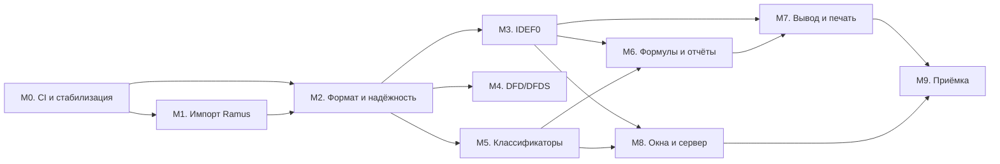

# Дорожная карта Tamus

Практический план развития Tamus от текущей беты до полноценного преемника Ramus. Документ уточняет раздел 27 [спецификации](TAURI_SVELTE_PROJECT.md) с учётом уже реализованного вертикального среза и служит точкой синхронизации статусов.

- Текущая версия: **0.1.0 (бета)**.
- Обновлено: **23 октября 2026 года**.
- Основание: [README.ru.md](../README.ru.md), [TAURI_SVELTE_PROJECT.md](TAURI_SVELTE_PROJECT.md), [IMPLEMENTED_IDEF0.md](IMPLEMENTED_IDEF0.md), [DFD_AND_APPEARANCE.md](DFD_AND_APPEARANCE.md), [I18N.md](I18N.md).

## Принципы

1. **Переносится поведение и данные, а не Java-классы.** Критерий — пользовательский сценарий и совместимость файлов, а не соответствие структуре исходного кода Ramus.
2. **Одно авторитетное состояние.** В desktop-режиме состояние, валидация, история и файлы принадлежат ядру Rust. Браузерный reducer повторяет тот же контракт и не должен расходиться с ним.
3. **Общие сценарии.** Каждое доменное изменение проверяется одним и тем же fixture в TypeScript и Rust.
4. **Никакой молчаливой потери данных.** Неизвестные поля, потоки и вложения сохраняются и диагностируются; неподдержанная возможность явно обозначается в интерфейсе и документации.
5. **Этап закрывается по результату.** Календарные сроки не используются: неизвестны полный корпус моделей, объём скриптов и требования серверной совместимости.

### Статусы готовности

Строка функциональной матрицы или задача проходит статусы:

`planned` → `implementation` → `fixture verified` → `desktop verified`

| Статус             | Значение                                                                       |
| ------------------ | ------------------------------------------------------------------------------ |
| `planned`          | Решение описано, кода нет                                                      |
| `implementation`   | Код есть, но нет подтверждающего общего сценария                               |
| `fixture verified` | Сценарий проходит в TypeScript и Rust на общем fixture                         |
| `desktop verified` | Поведение проверено в нативной сборке на целевой ОС с системными зависимостями |

Формальная полнота выпуска достигается только при `desktop verified` по всем обязательным строкам.

## 1. Текущее состояние

### Реализовано в бете 0.1.0

| Область             | Состояние                                                                                                                       | Подтверждение                                        |
| ------------------- | ------------------------------------------------------------------------------------------------------------------------------- | ---------------------------------------------------- |
| Оболочка приложения | Заголовок, управление окном, меню «Файл/Правка/Вид», настройки, справка, взаимоисключающие меню, подтверждение закрытия         | `test:shell`                                         |
| IDEF0               | Контекст A-0, декомпозиция 2–20, I/C/O/M, наследование интерфейсов, автоматическая ортогональная трассировка, дерево, нумерация | `test:idef0`, `fixtures/idef0-scenario.json`         |
| DFD                 | Процессы, внешние сущности, хранилища, направленные потоки, ограничения соединений, декомпозиция, границы контекста             | `test:shell`, `fixtures/dfd-scenario.json`           |
| Классификаторы      | Базовые элементы, поиск, сортировка, привязка к потокам; доступны в расширенном режиме                                          | `test:ramus`, `fixtures/ramus-workflow.json`         |
| Проект и история    | Несколько моделей, вкладки, инспектор, undo/redo до 100 изменений, защита от потери несохранённых данных                        | `npm test`, `test:ui`                                |
| Формат проекта      | `.tamus.json`, `schemaVersion: 1`, открытие старых файлов, перенос неизвестных полей                                            | `tests/project.test.mjs`                             |
| Локализация         | Русский и английский без перезапуска, словарь, склонения, перевод ошибок валидации, сохранение выбора                           | `test:i18n`, `fixtures/localized-decomposition.json` |
| Темы                | Светлая и тёмная, определение темы ОС, сохранение выбора                                                                        | `test:shell`                                         |
| Ядро Rust           | `tamus-core` без Tauri: команды, история, валидация, файлы; общие fixtures с браузерным reducer                                 | `cargo test`, `cargo clippy`                         |

### Ограничения и незакрытые области

- **Desktop не подтверждён.** Браузерные сценарии и тесты ядра не доказывают работу нативного host: нативные диалоги, окно и печать требуют сборки на целевой ОС. Linux-сборка зависит от GTK/WebKit/DBus development packages.
- **Редактор неполон.** Нет развилок и слияний общих потоков, туннелей, ручной правки изгибов и точек присоединения, полного контроля балансировки ICOM и политик распространения имён.
- **DFD базовый.** Нет формы процесса-эллипса, DFDS, привязки внешней сущности/хранилища к классификатору, общих потоков с развилками и туннелей.
- **Совместимость с Ramus частичная.** Есть импорт и экспорт `.rsf` для IDEF0/DFD с отчётом об импорте; YAML schema 4, вложения, история и точная cross-level геометрия Ramus пока не поддержаны.
- **Нет формул, отчётов, матриц, графиков, печати и экспорта.**
- **Нет нескольких окон, сервера и совместной работы.**
- **Нет CI.** Проверки выполняются локально; lock-файлы присутствуют, но не проверяются автоматически.
- **Документация частично устарела.** Например, в [разделе 2.2 спецификации](TAURI_SVELTE_PROJECT.md) указаны CSP `null` и отсутствие lock-файлов, тогда как в коде CSP настроена, а lock-файлы добавлены.

## 2. Этапы

### M0. Воспроизводимость и стабилизация беты

**Цель.** Любой чистый checkout собирается и проверяется одинаково, а известные дефекты и ограничения зафиксированы.

**Работы.**

- Зафиксировать toolchain: Node.js 20.19+, npm, stable Rust edition 2024; проверить актуальность `package-lock.json` и `Cargo.lock`.
- Настроить CI: `npm ci`, `check`, `test`, `format:check`, `build`; `cargo test` и `cargo clippy -- -D warnings` для `tamus-core`.
- Провести desktop smoke на Windows, macOS и Linux: запуск, открытие/сохранение, нативные диалоги, окно, темы, закрытие с несохранёнными изменениями.
- Ввести чеклист релиза и разделение каналов beta/stable.
- Завести публичный список известных дефектов и ограничений; синхронизировать README и спецификацию с фактическим кодом.
- Публиковать артефакты сборки по платформам, когда это позволяют runner'ы.

**Критерии выхода.**

- Чистый checkout проходит все проверки в CI.
- Нативная сборка вручную подтверждена минимум на одной ОС; результат и ограничения записаны.
- Известные ограничения беты перечислены в README или отдельном документе.
- Релиз 0.1.x воспроизводим из тега.

### M1. Данные Ramus и импорт

**Цель.** Читать существующие проекты Ramus без потери данных и объяснять каждое неподдержанное поле.

**Работы.**

- Создать `LegacyDocument` и инвентарь RSF: XML-потоки, ссылки, значения, вложения, бинарные данные.
- Реализовать чтение Ramus YAML schema 4 и декодирование известных бинарных потоков с версионированием.
- Построить отчёт об импорте: поддержано, неизвестно, отклонено, где именно.
- Подготовить Java oracle как dev-инструмент (не зависимость поставки) и корпус fixtures, включая `Пример модели.rsf`.
- Сделать диагностический readonly-viewer импортированных таблиц и диаграмм.
- Ввести семантический comparer и базовый round-trip корпус.

**Критерии выхода.**

- Известные fixtures читаются ядром Rust без GUI Java.
- «Пример модели.rsf» получает объяснимый результат, а не пустую модель.
- Неизвестные данные сохраняются и видны в диагностике.
- Ни одна область паритета не потеряна из реестра требований.

**Требования матрицы:** FILE-02, этап A.

**Текущее состояние (0.1.x).** Реализован обмен `.rsf` для IDEF0/DFD: чтение ZIP/XML-таблиц Ramus, модели и декомпозиции, блоки и геометрия, потоки I/C/O/M, классификаторы, присоединённые объекты и отчёт импорта. Есть fixture `fixtures/ramus-as-is.rsf` и round-trip тесты. YAML schema 4, вложения, история, отчёты и полный инвентарь покрытия ещё не реализованы; открытие экспортированного файла в настольном Ramus не проверено.

### M2. Нативный формат и надёжность данных

**Цель.** Детерминированное сохранение, восстановление после сбоя и отсутствие скрытых перезаписей.

**Работы.**

- Принять ADR о формате: целевой каталог `.tamus` с версионируемым YAML manifest против текущего `.tamus.json`; описать миграцию и политику `schemaVersion`.
- Реализовать детерминированный YAML writer, стабильные ID, provenance и сохранение неизвестных полей.
- Ввести `ProjectSession`, ревизии, staging/recovery intent и атомарную замену файлов.
- Добавить обнаружение внешнего редактирования, журнал рабочей сессии, восстановление и durable undo/redo.
- Покрыть сбои: падение между записями, переполнение диска, повреждённый файл, параллельные окна.
- Сохранить чтение старых `.tamus.json` без потери данных.

**Критерии выхода.**

- Повторное сохранение неизменённой модели не меняет файлы.
- Открытие после сохранения детерминировано.
- Recovery восстанавливает целое состояние во всех протестированных точках сбоя.
- Нет silent overwrite при stale revision или внешней правке.

**Требования матрицы:** FILE-01, FILE-03, HIST-01, этапы A/B.

### M3. IDEF0 до паритета

**Цель.** Полный редактор IDEF0, включая геометрию и cross-level семантику Ramus.

**Работы.**

- Перейти к графу сегментов: развилки, слияния, туннели, общие потоки.
- Добавить ручную правку изгибов и точек присоединения, подписи и оформление стрелок.
- Реализовать контроль балансировки ICOM и владельцев функций.
- Ввести политики распространения имени потока: безопасно, по ветви, везде.
- Добавить шаблоны, преобразования уровней и импорт ветви с ID remap и полным undo.
- Расширить проверку геометрии: fixtures, scene diff, undo одной drag-команды.

**Критерии выхода.**

- Сквозной пример из Ramus воспроизводится по семантике и геометрии.
- Переименование, смена роли и удаление родительской стрелки обновляют дочерние уровни в одной транзакции.
- Undo/redo восстанавливает данные и связанные интерфейсы целиком.

**Требования матрицы:** DGM-01…DGM-06, этап B/C.

### M4. DFD и DFDS

**Цель.** Довести DFD до самостоятельной нотации и добавить DFDS.

**Работы.**

- Добавить переключение формы процесса на эллипс и правила DFDS (роли, инструменты, ограничения).
- Реализовать общие потоки с развилками, туннели и ручную правку трасс.
- Разрешить привязку внешней сущности и хранилища к элементу классификатора.
- Проверить непрерывность потоков между уровнями и наследование границ.
- Расширить fixtures: допустимые и запрещённые соединения, виды объектов, декомпозиция, DFDS-правила.

**Критерии выхода.**

- DFD и DFDS проходят общие rule/fixture-тесты в TypeScript и Rust.
- Повторное открытие сохраняет семантику, геометрию и ссылки.
- Ограничения нотации объясняются в интерфейсе и документации.

**Требования матрицы:** DGM-07, DGM-08, этап C.

### M5. Классификаторы и значения

**Цель.** Полный набор типов значений, ссылок, иерархий и операций над справочниками.

**Работы.**

- Реализовать все простые типы, включая `null`, диапазоны, локали и форматирование.
- Добавить ссылки, варианты, матрицы проекций и виртуальные таблицы.
- Реализовать HTML, файлы, вложенные таблицы и историю цен.
- Поддержать иерархии и производные группировки без изменения исходного дерева.
- Добавить объединение, перенос и преобразование с предпросмотром последствий и переназначением всех ссылок.
- Сохранять поиск, иконки, сортировку, порядок и ширину колонок между запусками.

**Критерии выхода.**

- Q-01…Q-07 подтверждены fixtures и UI-сценариями.
- Переименование и удаление не нарушают ссылочную целостность.
- Вложения, порядок строк и история цен переживают сохранение и повторное открытие.

**Требования матрицы:** Q-01…Q-07, MX-01, MX-02, этап B/C.

### M6. Формулы, история, отчёты и графики

**Цель.** Перенести вычисления, отчётность, навигацию и графики.

**Работы.**

- Перенести парсер и вычислитель формул на Rust, автопересчёт по DAG, диагностику циклов и ошибок.
- Создать изолированный JS-исполнитель с совместимым API `EObject`, лимитами и ошибками; отдельно принять решение по JRuby.
- Реализовать типизированный AST отчётов, конструктор, реестр запросов (ICOM, владельцы, матрицы, «Все…») и JSSP/DocBook.
- Добавить readonly-viewer, историю и навигатор между моделями и объектами.
- Реализовать графики Bar/Pie, источники данных, серии и сохранение параметров.

**Критерии выхода.**

- Эталонный корпус формул совпадает с Java-oracle.
- Утверждённые шаблоны отчётов воспроизводятся, включая JSSP и DocBook.
- Скрипты не получают привилегий host UI; негативные тесты проходят.
- Графики сохраняют данные и параметры.

**Требования матрицы:** CALC-01…CALC-03, REP-01…REP-04, NAV-01, CHART-01, этап C/D.

### M7. Вывод, печать и обмен

**Цель.** Реальный экспорт и печать без маскировки форматов.

**Работы.**

- Ввести общую модель страниц и renderer для SVG, PNG и PDF.
- Реализовать нативный print adapter и документированные различия пагинации между WebView.
- Добавить XLS (BIFF) отдельно от XLSX/CSV; не выдавать одно за другое.
- Реализовать IDL-импорт/экспорт и импорт ветви.
- Принять решение по EMF через проверенный конвертер, а не через SVG renderer.
- Связать экспорт с реестром возможностей и provenance.

**Критерии выхода.**

- Каждый заявленный exporter создаёт файл, открываемый целевым приложением.
- PRINT-01 подтверждён на согласованных размерах, полях и страницах.
- Capability registry соответствует составу release bundle.

**Требования матрицы:** IO-01…IO-04, PRINT-01, NAV-02.

### M8. Несколько окон, сервер и совместная работа

**Цель.** Согласованные окна и сетевая работа с явной границей совместимости.

**Работы.**

- Подключить несколько view/window к одной `ProjectSession`, события открытия файлов и разрешение конфликтов.
- Реализовать `RemoteTransport`, отдельный процесс `tamus-server`, права, аудит, подписки и переподключение.
- Добавить администрирование пользователей, групп и журнала.
- Принять решение по legacy gateway: новый API с миграцией либо отдельный шлюз, но не неявная совместимость.
- Проверить большие проекты, stale revision и одновременное редактирование.

**Критерии выхода.**

- Все изменения видны во всех окнах; duplicate command не дублирует изменение.
- Сервер проверяет права на каждой операции.
- Переподключение и stale revision не теряют данные.

**Требования матрицы:** UI-03, NET-01, NET-02, этап D.

### M9. Приёмка и доставка

**Цель.** Подтвердить полноту переноса и выпустить проверенную версию.

**Работы.**

- Пройти cross-platform acceptance на утверждённых Windows, Linux и macOS.
- Проверить установщики, обновления, файловые ассоциации и миграцию схем.
- Закрыть доступность, keyboard-only сценарии, локализацию и performance budgets.
- Сверить каждый элемент исходного реестра команд с реализованным действием либо зафиксированным решением об устаревании.
- Обновить справку, About и release notes с явным compatibility profile.

**Критерии выхода.**

- Выполнены все критерии раздела 29 спецификации.
- Release notes явно называют compatibility profile и оставшиеся ограничения, если выпуск неполный.

**Требования матрицы:** все обязательные строки в статусе `desktop verified`.

## 3. Ближайший цикл

Приоритетные задачи до следующего публичного выпуска.

| Приоритет | Этап | Задача                                                   | Результат                                   |
| --------- | ---- | -------------------------------------------------------- | ------------------------------------------- |
| 1         | M0   | CI для frontend и `tamus-core`                           | Проверки на каждый push/PR                  |
| 2         | M0   | Desktop smoke на одной ОС                                | Подтверждённый отчёт о нативном запуске     |
| 3         | M0   | Список известных дефектов и синхронизация документации   | README и спецификация соответствуют коду    |
| 4         | M2   | ADR по формату `.tamus` и миграции `.tamus.json`         | Зафиксированное решение и план перехода     |
| 5         | M2   | Staging/recovery и fault injection для сохранения        | Тесты сбоев и восстановления                |
| 6         | M1   | Spike чтения RSF/Ramus YAML на реальных fixtures         | Отчёт о покрытии и неизвестных полях        |
| 7         | M1   | Диагностический readonly-viewer импортированного проекта | Видимый результат импорта без потери данных |
| 8         | M3   | Развилки/слияния и ручная правка трасс IDEF0             | Закрытие DGM-02                             |

## 4. Сводка по матрице паритета

Детальная матрица — [раздел 5 спецификации](TAURI_SVELTE_PROJECT.md#parity).

| Этап | Содержание                                                   | Текущее состояние                            |
| ---- | ------------------------------------------------------------ | -------------------------------------------- |
| A    | Основа, чтение, сохранение, совместимость                    | Частично: native save и обмен `.rsf`; YAML и вложения не поддержаны |
| B    | Основной локальный редактор и справочники                    | Частично: IDEF0/DFD и базовые классификаторы |
| C    | Расширенные локальные функции, отчёты, обмен, несколько окон | Не начато                                    |
| D    | Сервер, администрирование, остаточный legacy                 | Не начато                                    |

## 5. Зависимости

Оформление и UI можно развивать параллельно с чтением данных, но это не должно задерживать раннюю проверку потерь данных.

## 6. Риски

| Риск                                       | Ранняя проверка                               | Закрывается |
| ------------------------------------------ | --------------------------------------------- | ----------- |
| Потеря неизвестных значений плагинов       | Инвентарь импорта и диагностика               | M1          |
| Расхождение геометрии после импорта        | Малые fixtures и scene diff                   | M1, M3      |
| Непокрытый бинарный legacy-формат          | Версионированный decoder и Java oracle        | M1          |
| Повреждение файла при сбое записи          | Fault injection и протокол checkpoint         | M2          |
| Silent overwrite при нескольких окнах      | Revision, идемпотентность, конкурентные тесты | M2, M8      |
| Отличие нативного WebView от Chrome-тестов | Desktop smoke на каждой ОС                    | M0, M9      |
| Зависимость JS-шаблонов от Java            | Анализ host API и differential tests          | M6          |
| XLS/EMF не покрываются библиотекой         | Минимальный валидный writer spike             | M7          |
| Разная пагинация HTML/PDF                  | Один отчёт на всех target WebView             | M7          |
| Ограничения доступа только в UI            | Негативные IPC-тесты                          | M6, M8      |

## 7. Прототипы до фиксации зависимостей

| Вопрос                    | Требуемый результат                                                   | Этап |
| ------------------------- | --------------------------------------------------------------------- | ---- |
| Native ID generation      | Строковая схема с namespace/provenance, без `Long` → JS number        | M2   |
| Canonical YAML writer     | Детерминированный emitter; неизменная модель не меняет файлы          | M2   |
| Durable directory save    | Staging + recovery intent, проверенные точки сбоя                     | M2   |
| SQLite и рабочая проекция | Решение по журналу и индексам после замеров объёма                    | M2   |
| SVG text layout           | Зафиксированные шрифты и метрики, миграция bounds                     | M3   |
| Rich/code editor          | Svelte-совместимая интеграция после тестов CSP, клавиатуры и WebView  | M5   |
| XLS writer                | Отдельный BIFF exporter или явно переходный adapter                   | M7   |
| EMF writer                | Проверенный конвертер, а не SVG renderer                              | M7   |
| HTML printing             | Нативный print adapter и документированные различия                   | M7   |
| JRuby                     | Изолированный executor либо конверсия; иначе паритет открыт           | M6   |
| Legacy network            | Новый API с миграцией либо отдельный gateway                          | M8   |
| Server persistence        | Repository abstraction; БД выбирается после требований конкурентности | M8   |

## 8. Критерии полной готовности

Полный перенос завершён, когда одновременно выполнено:

1. Все обязательные строки матрицы имеют fixture и desktop verification; каждая исходная команда прослежена до обработчика и теста.
2. Приложение самостоятельно работает на утверждённых Windows, Linux и macOS и не требует JVM для локальных функций и основных форматов.
3. Импорт RSF/YAML сохраняет семантику, ссылки, историю, геометрию и вложения; неизвестное содержимое не уничтожается.
4. Native save/reopen детерминирован; journal, recovery и discard проверены на сбоях.
5. Undo/redo, несколько окон и внешняя правка не приводят к silent overwrite.
6. IDEF0, DFD, DFDS, матрицы, все типы атрибутов, формулы, отчёты и графики работают на согласованном корпусе.
7. Каждый заявленный формат вывода действительно поддержан и проверен; нет маскировки XLSX под XLS или SVG под EMF.
8. Обратный legacy-экспорт открывается эталонным Java-профилем, а ограничения новых возможностей видны до экспорта.
9. Сетевые функции, пользователи, доступ и аудит перенесены либо выпуск прямо обозначен как локальный и неполный.
10. Rich-описания, отчёты, скрипты и вложения не получают привилегий host UI; негативные тесты проходят.
11. Языки, keyboard-only сценарии, доступность и performance budgets проверены.
12. Пакеты устанавливаются и обновляются, file-open events работают, миграция схем сохраняет восстановление.

Готовый frontend build, несколько демонстрационных скриншотов или собранная оболочка эти условия не закрывают.

## 9. Проверки

Все команды выполняются из `tamus-app/`.

| Что проверяется      | Команда                                                                                               |
| -------------------- | ----------------------------------------------------------------------------------------------------- |
| Типы и Svelte        | `npm run check`                                                                                       |
| Модель и локализация | `npm test`                                                                                            |
| Форматирование       | `npm run format:check`                                                                                |
| Frontend-сборка      | `npm run build`                                                                                       |
| Ядро Rust            | `cargo test --manifest-path src-tauri/crates/tamus-core/Cargo.toml`                                   |
| Линт Rust            | `cargo clippy --manifest-path src-tauri/crates/tamus-core/Cargo.toml --all-targets -- -D warnings`    |
| Браузерные сценарии  | `npm run test:ui`, `test:idef0`, `test:ramus`, `test:shell`, `test:i18n` при запущенном `npm run dev` |

Браузерные сценарии пишут скриншоты в `.artifacts/`. Нативная сборка проверяется отдельно через `npm run tauri build` и запуск на целевой ОС.

## 10. Обновление плана

- Статус меняется только при наличии подтверждения: fixture, desktop-отчёт или ссылка на проходящий сценарий.
- Новая возможность сначала попадает в матрицу паритета с ID, затем в этап.
- Перенос между этапами фиксируется в описании соответствующего этапа, а не только в сводке.
- Даты добавляются только при взятом командой обязательстве; по умолчанию план остаётся результато-ориентированным.
- Изменения поведения приложения синхронно отражаются в [IMPLEMENTED_IDEF0.md](IMPLEMENTED_IDEF0.md), [DFD_AND_APPEARANCE.md](DFD_AND_APPEARANCE.md), [I18N.md](I18N.md) и README.
