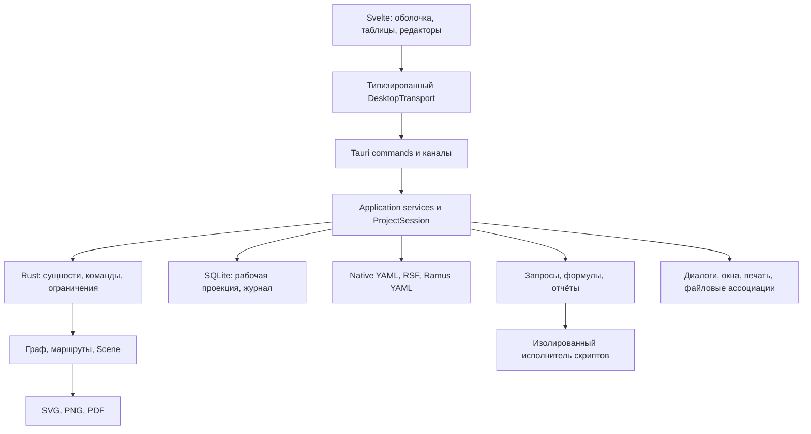
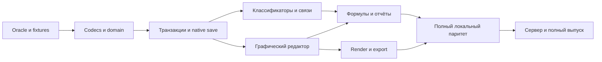

# Tamus: полный проект переноса Ramus на Tauri 2 + Svelte 5

Дата: **21 октября 2026 года**. Статус: **проектная спецификация для реализации**.

Документ описывает целевое приложение, архитектуру, модель данных, интерфейс, совместимость, последовательность переноса и критерии готовности. Он опирается на исходники Ramus, [ранее подготовленное исследование](../../docs/README.md), существующий шаблон `tamus-app` и официальную документацию Tauri/Svelte. Описанные ниже новые модули и команды — проектные решения; они ещё не реализованы.

Главное решение: **Svelte отвечает за представление и взаимодействие, самостоятельное ядро Rust — за данные, семантику диаграмм, транзакции и файлы; Tauri связывает ядро с ОС и WebView**. Сохраняется существующий SvelteKit в режиме статического SPA. JVM не требуется целевому приложению; Java остаётся инструментом разработки совместимости, пока перенос не завершён.

## Содержание

1. [Объём и определение полного переноса](#scope)
2. [Фактическое состояние репозиториев](#baseline)
3. [Основные архитектурные решения](#decisions)
4. [Карта переноса всех модулей Ramus](#module-map)
5. [Матрица функционального соответствия](#parity)
6. [Структура нового проекта](#structure)
7. [Предметная модель](#domain)
8. [Файлы, рабочая база, сохранение и восстановление](#storage)
9. [Команды, транзакции, отмена и несколько окон](#transactions)
10. [Контракт Tauri IPC](#ipc)
11. [Состояние Svelte и прикладные службы](#svelte-state)
12. [Оболочка, меню и пространства](#shell)
13. [Компоненты и диалоги](#components)
14. [Редактор IDEF0/DFD/DFDS](#diagram)
15. [Классификаторы, атрибуты и матрицы](#qualifiers)
16. [Формулы, JavaScript и история версий](#formulas)
17. [Отчёты и навигатор](#reports)
18. [Импорт, экспорт и печать](#exchange)
19. [Алгоритм миграции RSF/YAML](#migration)
20. [Границы доступа и недоверенное содержимое](#security)
21. [Расширяемость и реестр возможностей](#extensions)
22. [Серверная часть и совместная работа](#server)
23. [Локализация и доступность](#a11y)
24. [Производительность и фоновые задачи](#performance)
25. [Стратегия проверки совместимости](#testing)
26. [Сборка, выпуск и окружение](#delivery)
27. [План реализации с условиями перехода](#roadmap)
28. [Риски и решения до фиксации зависимостей](#risks)
29. [Критерии полной готовности](#done)
30. [Первая практически исполнимая задача](#first-task)
31. [Источники](#sources)

<a id="scope"></a>

## 1. Объём и определение полного переноса

Цель — полноценный преемник настольного Ramus для Windows, Linux и macOS. Приложение работает с несколькими моделями в проекте, справочниками и связями, строит диаграммы и документы, обменивается существующими данными и поддерживает восстановление после сбоя.

«Полностью» означает перенос **поведения и данных**, а не механическое соответствие каждого Java-класса компоненту Svelte. Реестр исходных требований формируется из [377 файлов GUI и связанных контроллеров](../../docs/16-ui-source-catalog.md), [1249 записей ресурсов](../../docs/17-ui-resource-catalog.md) и обработчиков команд. Эти числа описывают результаты статического исследования, а не количество самостоятельных экранов.

Нужно сохранить:

- Семантику работ, потоков, объектов классификаторов, собственников и декомпозиции.
- Все доступные типы атрибутов, ссылки, вложенные таблицы и файлы.
- Геометрию существующих диаграмм, подписи, развилки, туннели и оформление.
- Стандартные отчёты и их запросы, JSSP, DocBook, формулы и пользовательские функции.
- Матрицы, графики, навигацию, историю, внутренние ветви данных.
- Импорт/экспорт и возможность объяснить каждое неподдержанное поле без молчаливой потери.
- Сетевые возможности на отдельных этапах, с явной границей совместимости со старым сервером.

Первый полезный выпуск может покрывать меньше; в его интерфейсе и документации это обозначается явно. До завершения всех строк функционального соответствия его нельзя объявлять полным заменителем Ramus.

Изменение технологии само по себе не требует воспроизводить устаревшие способы доставки: JNLP, загрузку древнего JRE, JavaHelp и Swing docking заменяют современными механизмами. Их пользовательские функции — запуск, справка, раскладка — сохраняются.

<a id="baseline"></a>

## 2. Фактическое состояние репозиториев

### 2.1. Ramus

Исходники: `../../ramus`, версия из Metadata — 2.0.2. В Gradle включено 28 уникальных модулей; `web-service` существует отдельно и не включён в settings. Предыдущее исследование привязано к коммиту `f7aa5c49c41cdabc4777d63b5f3d6a48d17b1350`.

Ключевые точки сложности:

| Участок | Размер при текущем исследовании | Почему важен |
| --- | ---: | --- |
| `MovingArea.java` | 4049 строк | Состояния взаимодействия и редактирования |
| `SectorRefactor.java` | 2386 строк | Создание/изменение сегментов и связи уровней |
| `PaintSector.java` | 2646 строк | Геометрия и отрисовка стрелок |
| `PointBuilder.java` | 1124 строки | Построение маршрутов и опорных точек |

Это **10 205 строк только в четырёх графических классах**. Перенос редактора нельзя оценивать как замену нескольких прямоугольников на SVG.

Дополнительные факты, влияющие на проект:

- GUI открывает RSF; YAML schema 4 читается нижним слоем и конвертерами, но отклоняется обычным открытием в `Runner`.
- `idef0-report-core` со специализированными переходами отчётов не входит в статически найденную цепочку зависимостей `local-client`. В новом приложении регистрация этих возможностей должна проверяться явно.
- В коде есть IDEF0, DFD и DFDS, а также три типа отчётов: XML, JSSP, JSSP DocBook.
- Старые диаграммы могут хранить данные в бинарных потоках; новые миграции выносят текст и визуальные настройки в структурированные значения.
- `BlobMigrationTest` содержит список `KNOWN_UNOPENABLE` с файлом `Пример модели.rsf`. Сам факт наличия примера не доказывает, что текущая Java-версия открывает его.

### 2.2. Уже созданный Tamus

Приложение уже находится в [tamus-app](../tamus-app/README.md). Исследование не создаёт второй шаблон и не изменяет код этого приложения.

| Файл | Текущее состояние |
| --- | --- |
| [package.json](../tamus-app/package.json) | Svelte `^5.56.3`, SvelteKit `^2.65.1`, Vite `^8.0.16`, TypeScript `~6.0.3`, Tauri API/CLI `^2`; pnpm используется конфигурацией запуска |
| [Cargo.toml](../tamus-app/src-tauri/Cargo.toml) | Rust edition 2024; Tauri 2, opener, serde, serde_json |
| [lib.rs](../tamus-app/src-tauri/src/lib.rs) | Только команда `greet` и инициализация opener |
| [svelte.config.js](../tamus-app/svelte.config.js) | `adapter-static`, fallback `index.html` |
| [+layout.ts](../tamus-app/src/routes/+layout.ts) | `ssr = false` |
| [tauri.conf.json](../tamus-app/src-tauri/tauri.conf.json) | Окно 800×600, `frontendDist: ../build`, CSP отключена через null |
| [capabilities/default.json](../tamus-app/src-tauri/capabilities/default.json) | Разрешения `core:default`, `opener:default` для main |

Указаны **декларированные диапазоны**, а не проверенные установленные версии. Lock-файлы в исходной заготовке не обнаружены. До реализации нужно зафиксировать Rust toolchain, pnpm и lock-файлы, затем проверить совместимость сборки.

В доступном PATH найден Node, но не найдены pnpm, cargo и rustc; ранее не находилась Java. Приложения, тесты, IPC и графический экспорт в рамках подготовки документа не запускались.

### 2.3. Базовая конфигурация фронтенда

Сохраняются SvelteKit 2 и статическое SPA. Backend-операции идут через Rust IPC; файлы `+page.server.ts`, server actions и обязательный Node-сервер в настольном runtime не предусматриваются. Это соответствует [официальной схеме интеграции SvelteKit с Tauri](https://v2.tauri.app/start/frontend/sveltekit/). Существующие fallback и `ssr=false` уже направлены на такую конфигурацию.

Не нужно переписывать маршрутизацию на чистый Vite только ради Tauri. Внутри маршрутов приложение использует собственную модель вкладок; URL не является основным хранилищем состояния документа.

<a id="decisions"></a>

## 3. Основные архитектурные решения

Ниже — предлагаемые решения проекта, а не свойства, автоматически предоставляемые Tauri.

| Область | Принятое направление | Основание |
| --- | --- | --- |
| Оболочка | Tauri 2, существующий SvelteKit SPA | Есть шаблон; доступ к ОС отделён от UI |
| UI | Svelte 5 + TypeScript, CSS tokens и составные компоненты | Реактивные представления и контролируемая плотность рабочего интерфейса |
| Предметное ядро | Rust crate без зависимости от Tauri | Тестируется без окон, переиспользуется в CLI и сервере |
| Авторитетное состояние | Rust, один сериализованный обработчик команд на открытый проект | Все окна используют одинаковые данные и ограничения |
| Рисование | Собственный редактор поверх SVG | Сегменты, общие развилки и туннели требуют специальной семантики |
| Временная интерактивная геометрия | Локальный draft в TypeScript | Перемещение мыши не ждёт IPC |
| Подтверждённая геометрия | Rust, транзакционные команды | Одинаковая логика сохранения, проверки и экспорта |
| Основной формат | Каталог `.tamus` с версионируемым YAML manifest | Данные доступны для Git и ручного просмотра |
| Рабочая база | Локальная SQLite-проекция, журнал и индексы | Поиск, восстановление, история; не единственная копия модели |
| Совместимость | Изолированные RSF/XML, Ramus YAML v4 и бинарные адаптеры | Старый формат не определяет всю новую архитектуру |
| Расширения | Явные реестры типов, команд, отчётов и экспортёров | Можно проверять наличие возможностей при сборке и открытии |
| Скрипты | Изолированный исполнитель с совместимым API и лимитами | JSSP/формулы не исполняются в привилегированном WebView |
| Сервер | Отдельный процесс с тем же ядром и новым протоколом | Tauri-приложение не является сервером само по себе |

### 3.1. Общая схема



### 3.2. Как переходить с Java

Выбран перенос ядра на Rust с использованием Java как проверочного эталона. Постоянная поставка JVM вместе с Tauri противоречит цели независимого переписывания и оставляет старые ограничения. Временный headless Java-конвертер допустим в dev-инструментах и явно обозначенной переходной поставке, если конкретный старый бинарный формат пока не декодирован.

Переходный конвертер не должен становиться скрытой зависимостью команды «Открыть». Целевой критерий завершения: обычная поставка не требует JRE, Java классов и старого сервера для локальной работы.

<a id="module-map"></a>

## 4. Карта переноса всех модулей Ramus

Названия Rust-пакетов ниже проектные; они создаются постепенно, по мере выделения реальных границ.

| Модуль Ramus | Целевой модуль / представление | Содержательное действие |
| --- | --- | --- |
| common | tamus-domain, tamus-app-core, transport DTO | Перенести сущности, ограничения, события и семантику команд |
| core | domain, storage, compat, formula | Разделить движок, хранение и вычисления; не повторять Java reflection |
| database-storage | tamus-storage | SQLite schema, repositories и миграции рабочего состояния |
| data-framework-common | ProjectSession/ApplicationServices | Открытие, журнал, рабочие индексы и управление жизненным циклом |
| core-simple-attributes | AttributeTypeRegistry, ValueCodec, ValueEditorRegistry | Стандартные типы, ссылки, таблицы, история цен, вложения |
| gui-framework-common | contracts, CommandRegistry, PanelRegistry | Контракты представлений и команд |
| gui-framework-core | AppShell, DockLayout, NativeMenuAdapter | Оболочка, рабочие пространства, раскладка, About |
| gui-qualifier | qualifiers/attributes/projections/history | Таблицы, редакторы, поиск, иерархии, объединение, ветви |
| idef0-core | tamus-diagram + domain | Функции, сегменты, границы, точки, статусы, свойства |
| idef0-common | DiagramWorkspace и scene renderer | Интерактивный редактор, модели, DFD/DFDS, шаблоны, справка |
| idef0-report-core | QueryRelationRegistry | ICOM, собственники, роли и переходы по объектам |
| report-core | tamus-report, script-worker | AST отчётов, запросы, JSSP, DocBook, табличные данные |
| report-common | ReportWorkspace, ReportDesigner | Конструктор, XML, параметры, HTML/просмотр |
| script-framework | ScriptsWorkspace + script-worker | JS-модули и совместимый набор скриптов; JRuby отдельный пункт паритета |
| excel-import-export | tamus-exchange + ImportWizard | XLS/XLSX, сопоставление столбцов и проверка данных |
| print-to-pdf | tamus-render + PrintService | Общая модель страниц, шрифты и PDF |
| chart-common | ChartSpec/ChartData | Контракт источников данных графиков |
| chart-core | ChartService | Получение серий и зависимостей |
| chart-gui | ChartsWorkspace | Bar/Pie, источники и наборы графиков |
| local-client | src-tauri + AppShell | Запуск, файлы, восстановление, окна и упаковка |
| startup | Tauri startup/installer | Файловые ассоциации, single instance; Pack200 не нужен |
| project-navigator | ViewerWorkspace + OpenService | Просмотр и выбор файлов; сверить самостоятельные сценарии модуля |
| ramus-core-demo | tamus-cli + compat-oracle tools | Конвертеры, проверка модели и экспорт без GUI |
| storage-test | compat/fixture/property/render suites | Перенести смысл тестов, расширить корпус |
| net-common | versioned protocol DTO | Не переносить удалённые вызовы Java объектов буквально |
| client | DesktopTransport/RemoteTransport + AdminWorkspace | Подключение, пользователи, группы, журнал |
| server | tamus-server | Ядро, транзакции, доступ, API и события |
| light-server | server launcher/admin | Управление сервером, конфигурация и состояние |
| web-service, вне settings | viewer/server HTTP adapter | Изучить servlet-сценарии; JNLP заменить установщиком/ссылкой открытия |

Нужно отдельно перенести конфигурационные ресурсы, переводы, справку, демонстрационные модели, шаблоны, шрифты и иконки. Наличие в репозитории файла не равно разрешению удалить его при преобразовании.

<a id="parity"></a>

## 5. Матрица функционального соответствия

Этапы: **A** — основание/совместимость, **B** — основной локальный редактор, **C** — расширенные локальные функции, **D** — сервер и завершение полного паритета. Буква задаёт порядок, а не календарный срок.

| ID | Возможность | Целевая реализация | Этап и критерий |
| --- | --- | --- | --- |
| FILE-01 | Новый/открыть/недавние/мастер | WelcomeScreen + OpenService | A: native сохраняется и открывается повторно |
| FILE-02 | RSF и Ramus YAML | Compat adapters + import report | A: чтение известных данных без потерь |
| FILE-03 | Сохранить/как/восстановить | SaveCoordinator + journal | A: сбой записи не повреждает последний checkpoint |
| FILE-04 | RSF-экспорт | Profiled compatibility writer | C: файл открывается Java-эталоном для поддержанного профиля |
| UI-01 | Меню/панели/клавиши | Общий CommandRegistry | B: одна команда доступна из всех предусмотренных мест |
| UI-02 | Рабочие пространства/раскладка | DockLayout + local UI state | B: восстановление и сброс раскладки |
| UI-03 | Несколько окон | View subscriptions одной ProjectSession | C: события согласованы, duplicate command не дублирует изменение |
| Q-01 | Классификаторы и атрибут имени | QualifierService/Table | B: имя корректно в ссылках и списках |
| Q-02 | Все простые типы | Typed Value + редакторы | B: null, диапазоны, сохранение и локали |
| Q-03 | Ссылки/варианты/матрицы | Reference/Variant/Relation services | B: целостность после переименования и удаления |
| Q-04 | HTML/файлы/таблицы/цена | Специализированные редакторы | C: вложения, порядок строк и история цен сохраняются |
| Q-05 | Иерархии/группировки | Base tree + derived grouping | B: группировка не меняет исходное дерево |
| Q-06 | Объединение/перенос/преобразование | Atomic domain commands | C: переназначены все ссылки, есть preview последствий |
| Q-07 | Поиск/иконки/сортировка/колонки | Table state + query service | B: порядок и настройки переживают перезапуск |
| MX-01 | Два списка проекции | RelationBrowser | B: одиночный источник и множественные цели |
| MX-02 | Таблица проекции | VirtualMatrix | B: те же отношения видны в обоих видах |
| DGM-01 | IDEF0, блоки/стрелки/текст | Diagram engine + SVG scene | B: базовое создание, выбор и изменение |
| DGM-02 | Развилки/слияния/ручные точки | Segment graph | B: топология независима от визуального пересечения |
| DGM-03 | Декомпозиция/границы/туннели | Cross-level relation service | B: родитель и ребёнок обновляются одной транзакцией |
| DGM-04 | Собственники/типы/атрибуты | FunctionInspector | B: варианты вычисляются по тем же отношениям |
| DGM-05 | Распространение имени потока | Named rename policies | C: безопасное/по ветви/везде на проверочных графах |
| DGM-06 | Шаблоны/уровни/импорт ветви | ModelTransformService | C: ID remap и undo полного изменения |
| DGM-07 | DFD | External/DataStore/Process | C: создание, связи и повторное открытие |
| DGM-08 | DFDS | Roles + notation-specific tools | C: правила подтверждены отдельными fixtures |
| HIST-01 | Отмена/повтор | Durable command log | A/B: восстановление данных и зависимых свойств |
| HIST-02 | История значений/ветви | Branch snapshots + audit | C: старые ветви не теряются при импорте |
| CALC-01 | Формулы/автоизменение | Rust parser/evaluator + DAG | C: эталонный корпус совпадает |
| CALC-02 | Пользовательские JS-функции | Isolated compatibility runtime | C: EObject API, лимиты, ошибки |
| CALC-03 | JRuby console | Изолированный совместимый executor/конверсия | D: отдельный проверенный профиль или явно незавершённый паритет |
| REP-01 | Стандартный конструктор | Typed report AST + designer | C: надпись/таблица/колонка и XML обмен |
| REP-02 | Все переходы запросов | Typed query planner | C: ICOM/матрицы/собственники/Все... |
| REP-03 | JSSP | Parser + JS worker + compatibility facade | C: результаты совпадают на утверждённых шаблонах |
| REP-04 | JSSP DocBook | AST/DocBook + exporter registry | C/D: проверены заявленные поставщики вывода |
| NAV-01 | Внутренний просмотр/история | Readonly viewer | B/C: переходы между моделями и объектами |
| NAV-02 | Внешний браузер/HTML | Static export/local viewer service | C: ссылки и вложения работают без IPC доступа |
| CHART-01 | Bar/Pie/источники/наборы | ChartSpec + Svelte/SVG | C: данные и параметры сохраняются |
| IO-01 | XLS импорт/экспорт | Compat exchange adapters | C/D: настоящий XLS, без переименования XLSX в XLS |
| IO-02 | XLSX/CSV | Native exchange | C: новая возможность, не замена IO-01 |
| IO-03 | IDL импорт/экспорт | Grammar + mapping | C/D: fixtures из обоих редакторов |
| IO-04 | BMP/PNG/JPG/SVG/EMF | Exporter registry | C/D: каждый заявленный формат проверен |
| PRINT-01 | Страница/просмотр/принтер/PDF | Shared page layout/render | C: размер, поля и страницы совпадают с заданными |
| NET-01 | Подключение/права/пользователи | RemoteTransport + Admin | D: сервер проверяет права на каждой операции |
| NET-02 | Многопользовательское изменение | Ordered server command stream | D: stale revision и переподключение не теряют данные |
| HELP-01 | Справка/About/языки | Local docs + locale catalogs | B/C: вся основная UI поверхность переведена |

Для каждой строки нужно вести тесты и статус: planned → implementation → fixture verified → desktop verified. Формальная полнота достигается только при последнем статусе по всем обязательным строкам.

<a id="structure"></a>

## 6. Структура нового проекта

Расширяется уже существующий каталог `tamus-app`:

```text
tamus/
├── docs/TAURI_SVELTE_PROJECT.md
└── tamus-app/
    ├── package.json
    ├── pnpm-lock.yaml
    ├── svelte.config.js
    ├── vite.config.js
    ├── src/
    │   ├── routes/+layout.ts
    │   ├── routes/+page.svelte
    │   └── lib/
    │       ├── app/                 # composition root, sessions, navigation
    │       ├── contracts/           # generated DTO + runtime validation
    │       ├── transport/           # desktop, remote, test transports
    │       ├── commands/            # единая регистрация UI-действий
    │       ├── state/               # .svelte.ts projections / local UI state
    │       ├── shell/               # dock, menus, tabs, workspace
    │       ├── components/          # доступные UI-примитивы
    │       ├── features/
    │       │   ├── welcome/ qualifiers/ attributes/ projections/
    │       │   ├── models/ diagram/ reports/ viewer/ charts/
    │       │   └── history/ scripts/ import-export/ settings/ admin/
    │       ├── diagram/             # input machine, hit testing, SVG renderer
    │       ├── i18n/
    │       └── styles/
    ├── static/help/
    ├── src-tauri/
    │   ├── Cargo.toml               # desktop host + workspace
    │   ├── Cargo.lock
    │   ├── build.rs
    │   ├── tauri.conf.json
    │   ├── capabilities/
    │   ├── permissions/
    │   ├── src/
    │   │   ├── lib.rs              # composition root, plugins
    │   │   ├── commands/           # тонкие Tauri adapters
    │   │   ├── state.rs
    │   │   └── desktop/            # menu, windows, lifecycle
    │   └── crates/
    │       ├── tamus-domain/
    │       ├── tamus-app-core/
    │       ├── tamus-storage/
    │       ├── tamus-compat/
    │       ├── tamus-diagram/
    │       ├── tamus-formula/
    │       ├── tamus-report/
    │       ├── tamus-render/
    │       ├── tamus-cli/
    │       ├── tamus-script-worker/
    │       └── tamus-server/        # поздний этап
    ├── tests/                      # UI/desktop scenarios
    └── fixtures/                   # RSF, YAML, native, expected semantics
```

Перечисленные новые пути — целевая структура, не созданные файлы. Crates не дробятся ради каждой таблицы. Начальное ядро можно держать в domain/app-core/compat, выделяя formula/report/render по мере появления проверенного кода.

`tamus-domain` не импортирует Tauri, SQLite, WebView или компоненты Svelte. `src-tauri/src/commands` проверяет контекст вызова, десериализует DTO и вызывает application service; бизнес-правила не размещаются в `#[tauri::command]`.

<a id="domain"></a>

## 7. Предметная модель

### 7.1. Сущности

| Сущность | Обязательные данные и связи |
| --- | --- |
| Project | ID, format schema, набор моделей, manifest возможностей |
| Model | Имя, нотация, корневая функция, атрибуты функций, параметры |
| Qualifier | ID, имя, атрибут имени, пользовательские/системные атрибуты |
| AttributeDefinition | ID, имя, стабильный TypeKey, параметры типа, compatibility metadata |
| Element | ID, qualifierId, порядок, принадлежность базовой иерархии |
| AttributeValue | Типизированное значение, элемент, атрибут, branch/version контекст |
| Function | ID объекта, модель, тип работы, собственник, декомпозиция |
| Diagram | ID/владелец, нотация, объекты, граф сегментов, page settings |
| Stream | Общее содержательное имя, привязки объектов |
| Sector | Начало/конец, streamId, локальная подпись, стиль и маршрут |
| Junction | Явный узел развилки/слияния; пересечение линий не создаёт его |
| BoundaryLink | Связь порта/границы с соседним уровнем и режим туннеля |
| Projection | Определение отношения двух классификаторов и множество пар |
| Report | Тип, AST/исходный шаблон, параметры, маршруты запросов |
| Chart | Тип графика, источник, ключи, числовые серии, оформление |
| ChartSet | Список графиков и расположение внутренних карточек |
| Attachment | ID, имя, MIME, content hash, размер, источник |
| Branch/HistoryEntry | Родительская версия, comment, timestamp, actor, изменения |

Часть сущностей — типизированные представления системных классификаторов Ramus. При импорте нельзя создавать две независимые копии одной функции: системный элемент и Function должны ссылаться на одну идентичность.

### 7.2. Идентификаторы и типы на границе

- Новые сущности получают строковые ID; выбранная схема генерации фиксируется до записи первого native-format fixture.
- Для импорта сохраняется отображение `(sourceProject, kind, legacyNumericId) → nativeId` и исходный StableId. ID элемента и ID атрибута находятся в разных пространствах имён.
- Java `long`, включая значения больше `2^53−1`, передаётся в JSON десятичной строкой. TypeScript `number` для таких ID и целых значений не используется.
- Revision, sequence и branch identifiers также сериализуются строками, если допускают 64-битный диапазон.
- Не путать отсутствие значения, null, пустую строку, false и 0. Пустой список и неинициализированный список тоже различаются, если это существенно для исходного типа.
- Числа с плавающей точкой хранятся с явным профилем f64; NaN/Infinity не кодируются обычным JSON number и требуют отдельного тега/ошибки профиля.
- Для новых денежных значений возможен decimal. Импортированный legacy Double/Currency сохраняет исходную числовую семантику; автоматическая замена double на decimal не должна менять формулы и RSF round trip.
- Дата без времени, timestamp и исходная Java Date различаются. Native-value хранит семантический тип и исходное представление при необходимости обратного экспорта.

### 7.3. Пример DTO значений

Это эскиз контракта, а не добавленные в проект типы:

```ts
type EntityId = string;
type Revision = string;

type AttributeValue =
  | { kind: 'null' }
  | { kind: 'text'; value: string }
  | { kind: 'i64'; value: string }
  | { kind: 'f64'; value: number }
  | { kind: 'boolean'; value: boolean }
  | { kind: 'date'; value: string; semantics: 'calendar' | 'instant' }
  | { kind: 'reference'; elementId: EntityId | null }
  | { kind: 'element-list'; elementIds: EntityId[] }
  | { kind: 'variant'; optionId: string; label: string }
  | { kind: 'attachment'; attachmentId: EntityId }
  | { kind: 'table'; tableId: EntityId }
  | { kind: 'html'; source: string }
  | { kind: 'price-history'; records: { at: string; value: string }[] }
  | { kind: 'opaque'; typeKey: string; payloadRef: string };
```

Полный контракт дополнительно различает отсутствие записи, special-float, native-decimal, атрибуты цветов/шрифтов/графиков и параметры неизвестных плагинов. Произвольный Java object не передаётся как неограниченный JSON.

### 7.4. Инварианты

Ссылки ведут к существующим объектам соответствующего вида. Базовая иерархия ациклична. Атрибут имени принадлежит набору атрибутов классификатора. У диаграммы есть владелец. Конец сегмента имеет один определённый тип: порт функции, граница, junction или свободная точка. Cross-level link согласован с декомпозицией.

Удаление, слияние и перемещение проверяют входящие ссылки, формулы, отчёты, потоки, матрицы и историю. Для неподдержанных структур нельзя предполагать отсутствие ссылок только потому, что их формат неизвестен.

<a id="storage"></a>

## 8. Файлы, рабочая база, сохранение и восстановление

### 8.1. Три различных слоя

1. **Native-проект `.tamus`** — переносимая каноническая модель и содержимое вложений.
2. **Рабочая SQLite-база и журнал** — локальная материализованная проекция, очередь подтверждённых команд, recovery и индексы.
3. **Состояние UI** — раскладка, фильтры, открытые вкладки и viewport; оно не меняет содержательный hash проекта.

SQLite не обязана сохранять SQL-схему Java/H2. Её схема проектируется под новое ядро. Для Rust-подключения кандидат — [rusqlite](https://docs.rs/rusqlite/latest/rusqlite/). Транзакционность доменных команд и файлового checkpoint реализует Tamus, а не сама библиотека.

### 8.2. Native layout

```text
Orders.tamus/
├── project.tamus                 # format=tamus, storageSchema=1, projectId
├── attributes.yaml
├── qualifiers/<id>.yaml
├── models/<id>/model.yaml
├── models/<id>/diagrams/<id>.yaml
├── projections/<id>.yaml
├── reports/<id>/definition.yaml
├── reports/<id>/template.*
├── charts/<id>.yaml
├── branches/                     # immutable version manifests
├── attachments/<content-hash>
├── compatibility/                # исходные записи/metadata для round trip
├── .gitignore
└── .local/                       # только UI и необязательные локальные hints
```

Рабочая БД и recovery по умолчанию находятся в каталоге данных приложения и привязаны к canonical path + projectId. Это уменьшает случайное попадание SQLite/WAL в Git. Для переносимости модели они не требуются; для восстановления несохранённой сессии используются отдельно.

`project.tamus` и `project.ramus` — разные manifest-файлы. Собственная schema 1 не называется Ramus schema 4. Экспорт YAML v4 выполняет отдельный адаптер и проверяет его ограничения.

Native YAML записывается детерминированно: устойчивый порядок, явные типы, строки в кавычках, без anchors/aliases, без временных меток в неизменяемом содержимом. YAML parser-кандидат — [Saphyr](https://github.com/saphyr-rs/saphyr); канонический emitter и сравнение с legacy-диалектом требуют собственных fixtures.

### 8.3. Изменение и долговечность

Подтверждённая команда сначала становится durable в одной SQLite-транзакции вместе с её результатом/обратным изменением и новым состоянием рабочей проекции. Только после успешного commit UI получает подтверждение. Незавершённый pointer-draft не попадает в журнал.

Ручное сохранение создаёт native checkpoint. Флаг «изменён» определяется сравнением текущего содержательного hash с hash последнего сохранения, а не сравнением номеров revisions: undo может вернуть сохранённое содержимое на более новой revision.

### 8.4. Сохранение нескольких YAML-файлов

Простой rename одного manifest не делает запись каталога атомарной. SaveCoordinator должен:

1. Зафиксировать snapshot revision R и inventory ожидаемых файлов.
2. Записать новые/изменённые файлы во staging на том же filesystem, проверить их hash.
3. Сохранить recovery intent с перечнем замен, backup и ожидаемым checkpoint.
4. Применить замены управляемых файлов, не удаляя посторонние пути.
5. Последним обновить manifest/checkpoint marker и подтвердить успешное сохранение.
6. При запуске незавершённый intent детерминированно завершить или откатить.

OS/filesystem-specific replace и fsync проверяются на Windows/Linux/macOS. Нельзя объявлять весь многофайловый save атомарным без fault-injection тестов. Альтернативный immutable-generation layout рассматривается только если выбранный протокол не проходит проверки.

Запись RSF проще: временный архив рядом с целевым файлом, проверка содержимого, безопасная замена. После начала финального commit этапа отмена задания не должна оставлять «половину сохранения».

### 8.5. Внешнее редактирование и блокировки

Один процесс приложения владеет writable session выбранного canonical path. Второй экземпляр предлагает readonly/другой файл. Несколько окон внутри процесса разделяют одну session. Для сетевых/shared filesystem проектов нужна отдельная политика блокировок; локальный lock не заменяет сервер.

File watcher сравнивает hashes управляемых файлов. Внешнее изменение чистого проекта можно загрузить после валидации. При несохранённых локальных изменениях показывается конфликт с выбором reload, save copy или последующего merge. Автоматическое перезаписывание обеих версий недопустимо.

Recovery восстанавливает checkpoint и принятые после него команды. Каждый восстановленный результат можно сохранить отдельным проектом. Исходный импортированный RSF не изменяется до явного экспорта в него.

<a id="transactions"></a>

## 9. Команды, транзакции, отмена и несколько окон

### 9.1. Один путь записи

Любое содержательное изменение — `DomainCommand`. Включая перетаскивание блока, изменение ячейки, привязку документа к потоку, добавление уровня и импорт модели. Запрещены прямые записи UI в SQL, YAML или отдельный «локальный экземпляр модели».

```text
UI action
  → validate local draft
  → execute(projectId, requestId, expectedRevision, command)
  → context/access/compatibility checks
  → build ChangeSet + inverse + recalculation consequences
  → one durable transaction
  → CommandReceipt + ordered ProjectPatch
  → update all subscribed views
```

Сложная команда создаёт несколько низкоуровневых изменений, но одну пользовательскую undo-группу. Добавление уровня одновременно меняет дерево, diagram ownership и граничные связи. При ошибке ничего из этой группы не остаётся применённым.

### 9.2. Примеры доменных команд

| Группа | Команды |
| --- | --- |
| Классификаторы | CreateQualifier, UpdateQualifier, ReorderQualifiers, DeleteQualifier |
| Элементы | CreateElement, SetValue, ReparentElements, MergeElements, MoveElements |
| Атрибуты | CreateAttribute, AttachAttribute, SetNameAttribute, SetFormula |
| Матрицы | CreateProjection, SetRelation, ApplyRelationBatch |
| Модели | CreateModel, CreateDecomposition, InsertLevel, RemoveLevel, ImportSubtree |
| Диаграммы | AddFunction, MoveObjects, ResizeObject, ConnectSector, SplitSector, DeleteObjects |
| Потоки | SetStreamMembers, RenameStream, SetSectorLabel, SetTunnel |
| Представления данных | UpdateReportDefinition, UpdateChartDefinition |
| История | ForkBranch, ActivateBranch, UpdateBranchComment |

Undo/redo — application-команды над журналом с собственными проверками revision. Сохранение, открытие внешнего файла, экспорт и локальная раскладка не должны имитировать изменяемые объекты модели.

### 9.3. Журнал и производные значения

Одна запись содержит commandId, requestId, actor, base/result revision, branchId, timestamp, payload version, ChangeSet, inverse и семантическую метку для истории. Для больших импортов inverse может ссылаться на snapshot/пакет данных, а не держать мегабайты в памяти.

Автопересчёт детерминированных формул включается в ту же смысловую транзакцию. Если расчёт занимает долго, команда сначала подготавливается в фоновой задаче на snapshot; перед commit проверяется исходная revision. Нельзя незаметно применить результат к уже изменившейся базе.

Неопределённые источники (`RANDOM`, текущее время, скриптовый ввод) фиксируют фактический результат в ChangeSet. Redo воспроизводит сохранённый результат, если действие явно не означает повторное вычисление.

### 9.4. Конкурентные команды окон

Session хранит монотонно возрастающий номер revision. Команда с устаревшей `expectedRevision` получает `REVISION_CONFLICT`, текущий номер и возможность перечитать данные. Нельзя автоматически повторять структурное преобразование поверх другого состояния.

`requestId` обеспечивает идемпотентность повторной доставки в пределах документированного срока хранения. Повтор уже принятой команды возвращает прежний receipt. Срок хранения и связь с recovery фиксируются в протоколе; это не свойство IPC транспорта.

Смена ветви, закрытие проекта и импорт блокируют либо явно отменяют несовместимые активные черновики других окон. Активный текстовый ввод сохраняет собственный local draft; при внешнем изменении той же ячейки требуется разрешение конфликта, а не молчаливое затирание.

<a id="ipc"></a>

## 10. Контракт Tauri IPC

Tauri предоставляет команды с аргументами, результатами, ошибками и async обработчиками. Параметры и ответы описываются сериализуемыми типами; приложение добавляет генерацию TS DTO, runtime-валидацию границы и семантическое версионирование протокола. См. [Calling Rust from the Frontend](https://v2.tauri.app/develop/calling-rust/).

### 10.1. Публичная поверхность

Ниже проектные команды. Их имена и DTO фиксируются до первого вертикального среза.

| Команда | Вход / выход | Характер |
| --- | --- | --- |
| app_get_info | Версия, protocolVersion, capabilities | Чтение |
| project_new | Параметры мастера → session descriptor | Создание сессии |
| project_pick_source | Фильтры → FileGrant или cancelled | Нативный диалог |
| project_inspect_source | FileGrant → format/import diagnostics | Фоновое чтение |
| project_open | FileGrant/profile → projectId, summary | Загрузка сессии |
| project_attach | projectId/cursor/channel → snapshot/subscription | Подписка окна |
| project_detach | subscriptionId | Освобождение ресурсов |
| project_query | projectId, typed query, revision/cursor → page/scene | Чтение проекции |
| project_execute | RequestEnvelope → CommandReceipt | Единственный путь содержательной записи |
| project_undo / project_redo | projectId, revision, requestId → receipt | Транзакции журнала |
| project_pick_destination | Формат/назначение → FileGrant | Нативный диалог |
| project_save | projectId, destination grant, snapshot revision → jobId | Checkpoint |
| project_close | projectId, expected state → closed/needs-save | Жизненный цикл |
| recovery_list / recovery_restore | Recovery ID → descriptor/session | Восстановление |
| import_preview / import_commit | Mapping draft → diagnostics/job/receipt | Импорт |
| export_start | Формат, параметры, snapshot, FileGrant → jobId | Вывод |
| report_preview | ReportId, query, snapshot → jobId | Генерация |
| attachment_add / attachment_export | Выбранный файл/attachment ID → job | Контролируемые файлы |
| job_subscribe / job_cancel | jobId/channel → progress | Фоновые задания |
| settings_get / settings_update | Типизированные настройки | Локальное состояние |
| window_open_view | projectId + view descriptor → window label | Новое окно |
| remote_connect / remote_disconnect | Connection profile → session | Поздний этап |

`FileGrant` — непрозрачный идентификатор доступа, выданного Rust после диалога/OS-open event. Он привязан к окну/сессии, назначению и lifetime. Фронтенд не получает универсальную команду `read_any_file(path)` или произвольный SQL.

### 10.2. Пример запроса

```ts
interface ExecuteRequest {
  protocolVersion: 1;
  projectId: string;
  requestId: string;
  expectedRevision: string;
  command: {
    kind: 'MoveObjects';
    diagramId: string;
    positions: { id: string; x: number; y: number }[];
  };
}

interface CommandReceipt {
  requestId: string;
  commandId: string;
  previousRevision: string;
  revision: string;
  contentHash: string;
  patch: ProjectPatch;
  warnings: Diagnostic[];
}

interface ProjectPatch {
  schemaVersion: 1;
  projectId: string;
  baseRevision: string;
  revision: string;
  changes: EntityChange[];
  invalidatedQueries: string[];
}

interface EntityChange {
  entityKind: string;
  entityId: string;
  operation: 'upsert' | 'remove';
  value?: unknown; // В generated DTO — конкретный discriminated union.
}

interface Diagnostic {
  code: string;
  severity: 'info' | 'warning' | 'error';
  messageKey: string;
  entityIds: string[];
}
```

Эскиз не заменяет валидируемую схему. `unknown` в EntityChange нельзя оставлять в финальном API без проверки конкретного типа.

### 10.3. Ошибки

Rust возвращает `Result<T, ApiError>`, frontend transport нормализует rejection в типизированную ошибку. DTO содержит `code`, `messageKey`, безопасные параметры, `fieldErrors`, `diagnostics`, `retryable`, при необходимости currentRevision. Технический stack trace остаётся в диагностическом журнале.

Коды: `VALIDATION_FAILED`, `REVISION_CONFLICT`, `REFERENCE_IN_USE`, `ACCESS_DENIED`, `UNSUPPORTED_FORMAT`, `UNKNOWN_PLUGIN`, `COMPATIBILITY_LOSS`, `FILE_CHANGED_EXTERNALLY`, `FILE_LOCKED`, `JOB_CANCELLED`, `RECOVERY_REQUIRED`, `INTERNAL_ERROR`.

Отмена файлового диалога — штатный результат `cancelled`, а не ошибка. Ошибка чтения не превращается в пустой успешный проект.

### 10.4. Подписки и согласованность

Окно прикрепляется к session через handshake: под одним согласованным состоянием создаётся подписка, берётся revision и выдаётся snapshot/cursor. Изменения после этой revision поступают по ordered channel. Большие таблицы и сцены запрашиваются отдельно, привязанными к snapshot revision.

Обработчик patch:

1. Если patch уже применён — игнорировать повтор.
2. Если baseRevision совпадает с локальной — применить и обновить номер.
3. При разрыве последовательности запросить replay от cursor либо новый snapshot.
4. При закрытии окна освободить подписку; при повторном подключении повторить handshake.

Tauri channels подходят для потоковых данных; обычные events предназначены для небольших уведомлений и не дают granular capabilities-фильтрации данных. Это описано в [Calling the Frontend from Rust](https://v2.tauri.app/develop/calling-frontend/). Поэтому чувствительные данные доставляются адресно только после проверки подписки, а не глобальным broadcast.

Уведомление об изменении проекта, результат команды и durable log — разные уровни. Успешная отправка события не означает успешное сохранение команды.

<a id="svelte-state"></a>

## 11. Состояние Svelte и прикладные службы

### 11.1. Разделение состояния

| Состояние | Владелец | Примеры |
| --- | --- | --- |
| Domain | Rust | Элементы, значения, граф, формулы, отчёты |
| Read projection | Frontend transport/state | Видимая страница таблицы, scene текущей диаграммы |
| UI session | Svelte | Выделение, фокус, раскрытые узлы, активная вкладка |
| Interaction draft | Diagram/Table controller | Текущее перетаскивание или незавершённый ввод |
| Preferences | Local SettingsService | Тема, язык, раскладка, настройки таблиц |
| Job state | Rust + UI projection | Прогресс импорта, пересчёта, отчёта |

Нельзя сериализовать всю реактивную структуру UI обратно как проект. При IPC отправляются DTO-снимки данных, а не Svelte proxy, DOM node или callback.

### 11.2. Использование Svelte 5

Предлагается `$state` для локального UI и нормализованных проекций, `$derived` для вычисляемого представления. Крупные immutable snapshots можно держать через `$state.raw` и заменять по принятому patch; это не повод заново создавать всю DOM-сцену на каждое изменение.

Реактивные `Map`/`Set` нужно оформлять через поддерживаемые Svelte-структуры или явно заменяемые коллекции; обычный вложенный `Map` не следует считать автоматически глубоко отслеживаемым. Основание — [документация $state](https://svelte.dev/docs/svelte/$state).

Производные значения вычисляются без побочных эффектов. Для выбранных команд и фильтров используются [правила $derived](https://svelte.dev/docs/svelte/$derived). `$effect` применяется для интеграции renderer/listeners и освобождения ресурсов, но не для бесконечного «при изменении store отправить сохранение». Документация отдельно предупреждает о циклах при изменении состояния внутри [effects](https://svelte.dev/docs/svelte/$effect).

### 11.3. Службы фронтенда

`ProjectClient` управляет attach/query/execute. `SelectionService` хранит типизированное выделение. `CommandRegistry` вычисляет доступность действий. `DocumentTabService` адресует открытые объекты. `DialogService` управляет очередью модальных окон. `JobService` отображает задания и отмену. `NotificationService` отделяет диагностическую ошибку от обычного состояния. `LocalLayoutService` сохраняет раскладку.

Службы выдаются через composition root/context; компоненты не импортируют глобальный мутируемый singleton проекта. Это важно для нескольких проектов/окон и тестов.

Transport интерфейс имеет реализации Desktop, Remote и Fixture. В браузерном UI-тесте используется FixtureTransport, а не многочисленные подмены каждого компонента. Экспорт и ядро при этом всё равно требуют отдельных реальных интеграционных тестов.

<a id="shell"></a>

## 12. Оболочка, меню и пространства

### 12.1. Основная раскладка

```text
┌ Native menu / App menu ─────────────────────────────────────────┐
│ Global toolbar: New Open Save | Undo Redo | workspace | search   │
├ Workspace rail ┬ Navigator/tree ┬ Document tabs ┬ Inspector ─────┤
│ Models         │ Models        │ Diagram       │ Selection       │
│ Qualifiers     │ Qualifiers    │ Table         │ Properties      │
│ Projections    │ Search        │ Report        │ Flow/appearance │
│ Reports        │               │ Viewer/chart  │                 │
├────────────────┴───────────────┴───────────────┴─────────────────┤
│ Status: project, branch, unsaved, jobs, zoom, diagnostics         │
└─────────────────────────────────────────────────────────────────┘
```

Первое окно целесообразно увеличить относительно шаблонных 800×600 и задать минимальный рабочий размер после UX-проверки. Все размеры — в CSS logical units, с проверкой HiDPI и масштабирования ОС.

Для первого редактора достаточно CSS grid/split panes и собственного layout tree. Затем добавляются docking, таб-группы и отделение документа в нативное окно. Случайная библиотека docking не должна диктовать адреса документов или владение данными.

### 12.2. Пространства

- **Модели и диаграммы:** дерево моделей, холст, инспектор функции/потока.
- **Классификаторы:** список, таблицы, определения атрибутов и редактор значения.
- **Проекции:** список, два классификатора либо матрица.
- **Отчёты:** дерево, дизайнер/код, параметры, query/HTML/preview.
- **Просмотр:** read-only страницы, breadcrumbs, история переходов.
- **Графики:** список, источник, график и наборы.
- **История/скрипты/администрирование:** по готовности модулей и правам.

ID пространства стабилен, подпись локализуется. Горячие клавиши по позиции регистрации старых plugins заменяются явной конфигурацией, чтобы добавление модуля не перенумеровывало остальные сочетания.

### 12.3. Общий реестр команд

Каждое UI-действие имеет ID, messageKey, icon, group, menu placement, shortcut, `isVisible(context)`, `isEnabled(context)`, reasonDisabled и execute handler. Один источник обслуживает меню, toolbar, context menu и command palette.

Меню: Файл, Правка, Вид/Окна, Модель/Диаграмма, Данные, Сервис, Помощь; сетевые/административные команды появляются по правам и модулям. Изменение группировки относительно старого меню допустимо, если действие не теряется и доступно по поиску команды.

Нативное меню Tauri и HTML-меню используют одинаковые IDs. Контекст рисования и контекст поля ввода различаются: Ctrl/Command+C в текстовом редакторе не должен копировать блоки. Z/X/C/V/B/N работают только на холсте при отсутствии активного text editor.

### 12.4. Настройки и закрытие

Настройки разделяются на application, project, model/diagram и view/object. Скрытие столбца не удаляет атрибут; изменение шрифта программы не перезаписывает стили всех объектов без отдельной команды.

При закрытии последнего окна изменённой session предлагаются сохранить, закрыть без сохранения, отменить. При наличии background commit/save операция закрытия согласуется с SaveCoordinator. Освобождение одного view не закрывает проект, на который подписано другое окно.

<a id="components"></a>

## 13. Компоненты и диалоги

### 13.1. Базовые компоненты

`Button`, `IconButton`, `Menu`, `ContextMenu`, `Toolbar`, `Tabs`, `Dialog`, `Popover`, `Tooltip`, `SplitPane`, `Tree`, `TreeGrid`, `DataGrid`, `VirtualMatrix`, `PropertyGrid`, `ComboBox`, `EntityPicker`, `ColorPicker`, `FontPicker`, `DateInput`, `FileValueEditor`, `RichTextEditor`, `CodeEditor`, `ProgressPanel`, `DiagnosticList`.

Это набор составных компонентов, а не требование написать каждый HTML primitive вручную. Внешние UI/editor библиотеки подключаются после проверки Svelte 5, accessibility, CSP, keyboard handling, лицензии ресурсов и поддержки WebKit/WebView2. Их список не фиксируется на основании одного демо.

### 13.2. Экранные контракты

| Компонент | Вход | Результат/поведение |
| --- | --- | --- |
| ProjectWizard | Локализованные defaults | Draft проекта и начальных справочников |
| ModelTree | Model projection, selection | Открыть диаграмму, создать модель, структурные команды |
| QualifierTree | Справочники и группы | Открыть, переместить, свойства |
| QualifierTable | Query descriptor + column prefs | Paged rows, typed edit, batch command |
| AttributeCatalog | Type descriptors | Создание и редактирование определения |
| ValueInspector | ElementId + AttributeId | Правильный type-specific editor |
| ElementInspector | ElementId | Вертикальный PropertyGrid |
| EntityPickerDialog | Разрешённые типы/классификаторы, cardinality | Список ID; имя не заменяет ссылку |
| ProjectionEditor | ProjectionId | Два списка/матрица одного отношения |
| DiagramEditor | Scene + notation capabilities | Local draft, затем semantic command |
| FunctionInspector | FunctionId | Имя, атрибуты, тип, owner, оформление |
| FlowInspector | SectorId + StreamId | Members, label, rename policy, tunnel |
| ReportDesigner | ReportId/AST | Изменения формы через команды |
| ReportPreview | Snapshot + report parameters | Изолированный документ и diagnostics |
| ChartEditor | ChartSpec | Проверенные source mappings и appearance |
| HistoryView | Branch/history projection | Просмотр, fork, activate, comment |

### 13.3. Диалоги, которые необходимо покрыть

1. Начальный загрузчик, новый проект, новая модель.
2. Open/save destination, анализ импорта, recovery и внешнее изменение файлов.
3. Свойства проекта/программы/модели/диаграммы.
4. Создание атрибута, параметры типа, порядок атрибутов, видимость колонок.
5. Иерархия группировки, формула, пересчёт, выбор объектов, объединение/перенос с последствиями.
6. Создание проекции, выбор источника и набора связей.
7. Декомпозиция/шаблон/число блоков/нотация, вставка/удаление уровня.
8. Свойства блока, потока, туннеля, текста, DFD-объекта, роли DFDS.
9. Создание отчёта/его типа, XML импорт/экспорт, параметры запросов.
10. Источник графика, свойства графика, набор графиков.
11. XLS mappings, IDL mappings, image export, page setup, print preview, PDF/printer.
12. JS-модули, legacy script diagnostics, история/ветви, пользователи/группы/пароль.

Точная сверка полей выполняется с [исходным справочником диалогов](../../docs/18-dialog-reference.md). Нельзя считать «Свойства» перенесёнными, если новая панель меняет только имя, но теряет term attribute, статус, читателей или ordering.

### 13.4. Состояния компонентов

Каждое крупное представление должно различать loading, empty, ready, dirty draft, readonly, unsupported, error, conflict. При неподдержанном типе выводятся его имя и диагностика; пустой текстовый editor не используется как замена неизвестного значения.

PropertyGrid проверяет тип и диапазон локально для удобства, но окончательное решение принимает Rust. Модальные окна поддерживают Escape/возврат фокуса; долгий импорт живёт в Jobs, а не блокирует всё приложение модальным спиннером.

<a id="diagram"></a>

## 14. Редактор IDEF0/DFD/DFDS

### 14.1. Почему нужен специализированный граф

В Ramus стрелка может разветвляться, несколько сегментов могут иметь общий поток, имя и локальные подписи. Концы связаны с портами функций, junction, границами и соседними уровнями. Поэтому простая модель `edge { sourceNode, targetNode }` недостаточна.

Готовый flowchart component допустим как эксперимент для viewport/selection, но перед выбором обязан пройти тесты разветвления, ручной ортогональной геометрии, cross-level links, локальных подписей и сохранения точек. По умолчанию проект использует собственный SVG scene renderer; эта рекомендация основана на устройстве исходного редактора.

### 14.2. Разделение представлений

**Semantic graph** хранит функции, потоки, junction и отношения уровней. **Diagram layout** хранит рамки объектов, маршруты, точки, labels и стили. **Scene** — вычисленный набор примитивов для отображения/экспорта. **InteractionState** — незавершённое действие пользователя.

Не следует вычислять semantic graph обратно из SVG path. Перемещение видимой точки не создаёт автоматически предметное отношение.

```ts
type Endpoint =
  | { kind: 'function-port'; functionId: string; side: 'left' | 'top' | 'right' | 'bottom'; offset: number }
  | { kind: 'diagram-boundary'; diagramId: string; side: string; offset: number }
  | { kind: 'junction'; junctionId: string }
  | { kind: 'free'; x: number; y: number };

interface SectorLayout {
  sectorId: string;
  from: Endpoint;
  to: Endpoint;
  points: { x: number; y: number; lock: 'manual' | 'auto' }[];
  label: { x: number; y: number; width: number; height: number };
}
```

Строковые side/type в финальном DTO заменяются конкретными enum. Legacy `-1` sentinel преобразуется явным адаптером, а не превращается в допустимый native-ID.

### 14.3. Ввод как конечный автомат

Состояния: Idle, Selecting, DraggingObjects, Resizing, CreatingFunction, ConnectingSector, DraggingWaypoint, PlacingLabel, EditingText, Panning. Выбранный инструмент и активный interaction state разделены.

Pointer-down фиксирует исходный snapshot/selection и делает pointer capture. Pointer-move меняет только draft, hit targets и preview. Pointer-up создаёт одну semantic command. Escape отменяет draft, не создавая undo-запись. Потеря capture/фокуса и закрытие окна завершают interaction безопасно.

При перемещении нескольких объектов сохраняются относительные смещения. Snap/grid выполняется в координатах модели, а не экранных пикселях. Zoom/pan/DPI входят только в transform renderer/hit testing.

### 14.4. Координаты, hit testing и маршрут

Для native-диаграммы выбираются фиксированные logical model units; legacy units преобразуются через явно версионированное соответствие. Изменение размера окна не перезаписывает координаты проекта.

Hit testing использует геометрию scene и spatial index. У стрелки есть более широкая невидимая hit-зона, независимая от толщины линии. Выбор текста, линии и узла развилки различается. Пересечение путей не считается junction без записи в semantic graph.

Rust router строит ортогональные пути с ограничениями портов, obstacle clearance, минимальных сегментов и ручных точек. При равных вариантах используется устойчивый tie-breaker. Сначала переносится совместимый результат старого routing; новый улучшенный autoroute — отдельная команда, не скрытая миграция всех схем.

Во время drag TypeScript показывает локальный preview перемещённых рамок/прилегающих концов. Подтверждённый маршрут возвращает Rust. Если маршрутизация заметно меняет draft, UI отображает финальный результат; нельзя параллельно поддерживать две конкурирующие канонические реализации router.

### 14.5. Cross-level семантика

Декомпозиция, новые границы и туннели изменяются транзакционно. `BoundaryLink` хранит связь parent endpoint ↔ child boundary и tunnel mode. Мягкое туннелирование с наследованием для отчётов сохраняется отдельным значением; оно не вычисляется по виду нарисованных скобок.

Проверки: отсутствующие парные границы, ссылки на другую модель, циклическое владение диаграммами, допустимые варианты конца стрелки. При удалении уровня проводится remap связей и проверка, а не только удаление вкладки.

### 14.6. Переименование и содержимое

`Stream.name`, `Sector.labelOverride` и attached members остаются отдельными полями. Политики переименования — явный enum safe/downstream/allConnected с совместимыми правилами Ramus. Они тестируются на циклах/развилках и именованных сегментах, чтобы обход не зависал и не переименовывал посторонние ветви.

Список owner вычисляется из разрешённых классификаторов и механизмов функции. Изменение прикреплённых объектов инвалидирует варианты owner и отчётные queries. Видимая подпись не заменяет member references.

### 14.7. Нотации и расширенные команды

IDEF0, DFD и DFDS используют общий viewport, selection, undo и свойства, но разные наборы shapes/ports/rules. DFD добавляет external entity/data store. DFDS добавляет роли и собственные связи; точная семантика подтверждается тестами существующих классов, не догадкой по названию режима.

Обязательны text annotations, тильда, прозрачный фон подписи, стили линий/шрифтов/цветов, центрирование, копирование оформления, шаблоны, контекстные меню, clipboard объектов, удаление и импорт поддеревьев с remap ID.

### 14.8. Общая Scene для экранов и экспорта

Scene содержит paths, shapes, text runs/line breaks, markers, clipping и page frame. SVG для экрана и экспорт строятся из одной логической сцены. Canvas-ускорение допустимо после профилирования и не меняет её контракт.

Шрифты и переносы — отдельная задача: Java AWT и WebView могут измерять один текст по-разному. Для новых диаграмм фиксируется шрифтовый набор и layout version; импорт сохраняет исходные font/style/bounds и при необходимости применяет измеренные compatibility metrics. Для строгого совпадения экспорт может использовать glyph outlines. Встроенные font-файлы переносятся только после проверки ресурсов проекта.

Растровое равенство разных renderer не объявляется автоматически. Сначала сравниваются topology, coordinates, labels и bounds, затем визуальные отклонения.

<a id="qualifiers"></a>

## 15. Классификаторы, атрибуты и матрицы

### 15.1. Таблицы и иерархии

TreeGrid запрашивает строки страницами, отдельно хранит expansion и column layout. Порядок элементов задаётся устойчивыми order keys. Базовая иерархия — domain tree; группировка по атрибутам — query projection, не записывающая искусственных родителей в модель.

Перетаскивание между строками означает изменение порядка, на строку — изменение родителя; интерфейс различает эти drop targets. Сортировка внутри уровней и временная сортировка представления должны иметь разные команды/подписи.

Объединение дубликатов строит preview: какие ссылки, потоки, формулы и отношения будут заменены. Подтверждение применяет всё атомарно. Перенос в другой классификатор показывает несовпадающие атрибуты и не теряет их молча. Если требуется точное legacy-поведение с потерей необщих атрибутов, это отдельный подтверждаемый режим с перечислением последствий.

### 15.2. Реестр типов и редакторов

| Тип | Native representation | Редактор/проверки |
| --- | --- | --- |
| Text | String | Одно-/многострочный, пустое и null отдельно |
| Long | i64/string DTO | Диапазон и точность без JS number |
| Double | f64 + специальный профиль | Локальный ввод и стабильное хранение |
| Boolean | bool/nullable | Три состояния при nullable типе |
| Date | CalendarDate/Instant/legacy metadata | Чёткая timezone семантика |
| Currency | Native/legacy number + format metadata | Валюта и число знаков не меняют значение |
| Price | Ordered dated values | Добавление/удаление записей, итог по правилам Ramus |
| OtherElement | Typed reference | Picker допустимых элементов |
| Variant | Stable option ID + label | Изменение вариантов не теряет прежние значения |
| ElementList | Relation set | Picker/проекция |
| File | Attachment reference | Добавить, извлечь, открыть внешним приложением |
| Table | Nested row entities + column defs | Своя иерархия, порядок, вычисления |
| HTMLText | Source + safe rendering projection | Rich editor и просмотр исходника |
| IDEF0/Chart types | Typed extension values | Цвет, шрифт, owner, функция, chart links |
| Unknown | Opaque payload + type metadata | Readonly diagnostic вместо текстового редактора |

Любой editor выдаёт draft `AttributeValue`, но не записывает backend сам. Default display имени берётся из атрибута имени, а не из первого столбца таблицы.

### 15.3. Матрицы

В storage отношения нормализованы как набор пар `(projectionId, leftId, rightId)`. Стандартный вид и матрица выполняют одинаковые SetRelation команды. Дубли не добавляются; удаление ссылки не удаляет сам элемент.

Матрица виртуализируется по строкам и столбцам. Плотный массив из произведения размеров не создаётся при открытии. Поддерживаются keyboard navigation, Space toggle, выделение диапазона и batch changes, если они введены как новые явно описанные функции.

<a id="formulas"></a>

## 16. Формулы, JavaScript и история версий

### 16.1. Собственный язык формул

Парсер переносится с сохранением констант, ссылок `[Атрибут]`, внешних ссылок, функций с разделителем `;`, условного оператора и приоритетов. Исполнение через JavaScript `eval` недопустимо: операторы `=`, `^`, NULL и строковые преобразования отличаются от JS.

Formula AST ссылается на разрешённые ID, сохраняя исходный текст для пользователя/обратного экспорта. Rename изменяет отображение ссылки, а не уничтожает её привязку. Неоднозначные имена при импорте становятся диагностикой, а не случайным выбором первой строки.

Функции оформляются descriptors: имя, arity, типы, determinism, evaluator. Переносятся ABS/CEIL/FLOOR/LENGTH/MAX/MIN/N/NUMBER/RANDOM/ROUND/S/STRING/SQRT/SUBSTRING и найденные расширения. Точная семантика округления, строкового сравнения, NULL и левой ассоциативности проверяется дифференциально.

### 16.2. Автопересчёт

Dependencies образуют граф: ячейка → используемые значения/функции. Изменение строит ограниченную affected closure, проверяет цикл, вычисляет в устойчивом порядке. Ошибки хранятся как diagnostics значения, не преобразуются в 0 без правила исходного языка.

Циклы показываются с путём ссылок. Массовый пересчёт исполняется snapshot-задачей с отменой и CAS commit. Переименование, удаление и перемещение элементов инвалидируют нужные зависимости.

### 16.3. JS/JSSP исполнитель

Кандидат — QuickJS через [rquickjs](https://docs.rs/rquickjs/latest/rquickjs/struct.Runtime.html), где есть memory limit и interrupt handler. Эти механизмы помогают ограничить выполнение, но не заменяют процессную изоляцию и контроль host API.

Для недоверенных legacy-скриптов проектируется отдельный `tamus-script-worker` с ограниченным IPC. ОС sandbox и ресурсные ограничения проверяются отдельно на каждой платформе. Worker не получает Tauri handle, filesystem grants, сетевые credentials и произвольные Rust callbacks.

Совместимый facade предоставляет только нужные EObject methods, read-only данные snapshot и ограниченный вывод. Документируются различия Java Date/number coercion и доступов к Java classes. Шаблоны с обращением к JVM не считаются автоматически совместимыми с QuickJS: они требуют конверсии или отдельного legacy-профиля.

JRuby console не покрывается переносом JavaScript. До появления выбранного Ruby executor или проверенной конверсии эта строка полного паритета остаётся открытой. Прятать её в разделе «скрипты поддерживаются» нельзя.

### 16.4. История и ветви

Нужно разделить пользовательский undo, долговременный audit, внутренние ветви модели и Git-историю файлов. Это четыре разных механизма.

Предлагается native-дерево immutable snapshots и изменяемых branch heads. Импорт сохраняет все legacy branch/valueBranch данные; первый рабочий snapshot строится по активной ветви. Нельзя экспортировать только текущие значения, назвав это сохранением всех версий.

Операции fork/activate/comment должны иметь отдельные доменные команды с явно описанными последствиями. Старые ограничения необратимости/невозможности merge описываются в compatibility profile. Новое слияние ветвей не входит автоматически в перенос: для него нужен отдельный алгоритм конфликтов по сущностям и связям.

<a id="reports"></a>

## 17. Отчёты и навигатор

### 17.1. Общий pipeline

```text
Project snapshot + selected base elements
  → parse/validate report definition
  → typed query plan
  → rows + scalar values + diagnostics
  → report document IR
  → HTML / DocBook / page layout / export
```

Стандартный XML-отчёт преобразуется в версионированный AST: Report, Label, Table, Column, header/body properties, styles, query expressions и условия печати. Исходный XML сохраняется для диагностики и обратного обмена, но UI не редактирует его случайными строковыми заменами.

Дизайнер предоставляет форму, запрос, HTML и просмотр, как исходный редактор. Слева дерево отчётов, в центре форма/код, справа свойства выделенного компонента. Создание/удаление/перестановка компонентов выполняется через команды и поддерживает undo.

### 17.2. Семантика запросов

Query parser выделяет именованные шаги, затем resolver связывает их с ID и отношениями. QueryRelationRegistry содержит переходы от работ к потокам, от потоков к объектам и работам, от объектов к работам, матричные и OtherElement ссылки.

Нужно сохранить:

- Различие обычных переходов и `Все...`, включающих составные работы.
- Влияние туннелей с наследованием на дочерние элементы.
- Различие собственника и участника механизма.
- Порядок, дедупликацию и контекст текущей строки по правилам исходного движка.
- Приоритет реального атрибута перед одноимённым ключевым словом.
- Код, КодIDEF0, НПП и связность префикса подстановки с запросом таблицы.
- Базовый классификатор, выбранную модель, единый базовый классификатор, фильтр «Печатать для».
- Скрытие надписи, связанной со следующей пустой таблицей.

Реестр переходов тестируется на старте и в CI. Если модуль отсутствует, появляется понятное «переход недоступен», а не пустой успешный отчёт. Это непосредственно устраняет обнаруженную в Java-сборке неоднозначность состава зависимостей.

### 17.3. JSSP/DocBook

Parser распознаёт текст, `<% ... %>` и `<%= ... %>` с корректными границами/позициями ошибок. Выполнение идёт в script-worker. Совместимые `doc/document/out/data` предоставляются ограниченным facade; результаты получают размерные лимиты и диагностику.

JSSP — не тождественный стандартным формулам язык. Java API внутри старого шаблона может потребовать отдельного adapter или ручной конверсии. Автоматический мигратор выдаёт отчёт использованных host capabilities и явно отмечает несовместимые обращения.

DocBook импорт/экспорт сохраняет структуру. Конкретные DOCX/ODT/PDF outputs не обещаются по одному наличию DocBook: каждый exporter имеет свой capability и тесты. Для завершения REP-04 требуется инвентаризация реально использовавшихся старых exporter providers.

### 17.4. Навигатор

Viewer использует те же snapshot/query/scene services. История навигации хранит document descriptors, а не Java URL вида старого servlet. Есть back/forward/home/refresh, breadcrumbs и ссылки на модель, диаграмму, элемент и отчёт.

Внутренний viewer не запускает HTTP-сервер для каждой страницы. Внешний просмотр реализуется экспортом статического набора либо отдельным ограниченным localhost viewer. Последний не получает права записи проекта и не становится автоматически многопользовательским web editor.

HTML отчётов и импортированные rich descriptions показываются изолированно; подробнее в разделе 20. Ссылка на вложение проходит через attachment service, а не открывает произвольный локальный путь.

<a id="exchange"></a>

## 18. Импорт, экспорт и печать

### 18.1. Контракт импортёра/экспортёра

Каждый adapter имеет format ID, поддержанные версии, detect/inspect, plan, execute и diagnostics. Preview показывает список сущностей, новые ID, конфликты, неподдержанные данные и потенциальные потери. Commit применяет подготовленный результат к всё ещё актуальному snapshot.

Export принимает immutable snapshot, options и destination grant. Он не должен менять модель ради получения изображения или пересчитывать недетерминированные формулы без явно выбранного режима.

### 18.2. Табличный обмен

Для чтения XLS/XLSX кандидат — [calamine](https://docs.rs/calamine/latest/calamine/); для записи нового XLSX — [rust_xlsxwriter](https://rustxlsxwriter.github.io/). Это разные задачи: XLSX writer не реализует старый бинарный XLS.

Для **полного паритета XLS-экспорта** остаётся обязательная отдельная работа: выбрать BIFF writer и проверить его на fixtures либо реализовать изолированный compatibility exporter. Пока такой writer не выбран и не проверен, IO-01 остаётся незавершённым. Нельзя выдавать XLSX с расширением `.xls`.

ImportWizard сохраняет выбор листа/всех листов, начальную строку, «имя листа», «не импортировать», сопоставление колонок и уникальность. Поддерживает preview типов/ошибок и отчёт о пропущенных строках. Идентификаторы не вычисляются из отображаемого текста без правила уникальности.

CSV/XLSX — дополнительный современный обмен, а не резервная копия модели. Даты Excel, пустые ячейки, формулы книги, locale separator и ведущие нули требуют отдельных проверок.

### 18.3. IDL, XML и перенос поддерева

IDL parser/writer строится по существующим `IDLImporter`, `IDLExporter`, `IDLWriter` и корпусу файлов. Если неизвестна часть грамматики, она сохраняется как raw fragment или блокирует обещание обратной совместимости.

При импорте модели/поддерева все внутренние ID remap-ятся согласованно: функции, потоки, точки, атрибуты, владельцы, chart/report links. Одноимённость не означает идентичность; UI отдельно предлагает стратегию сопоставления справочников.

XML шаблона отчёта переносит определение, но не все данные проекта. После переноса валидируются его базовый классификатор, модель, type keys и запросы.

### 18.4. Графическое представление

Канонический экспорт диаграммы — SVG из Scene. Для raster candidate — [resvg](https://github.com/linebender/resvg), для векторной PDF-конверсии SVG — [svg2pdf](https://docs.rs/svg2pdf/latest/svg2pdf/). Их соответствие используемым SVG-примитивам, шрифтам и лицензируемым ресурсам проверяется отдельным spike.

PNG/BMP/JPG формируются из одинаковой сцены с заданными размером/DPI/background. SVG/EMF — разные форматы; EMF не появляется автоматически из SVG. Для EMF требуется отдельный exporter/конвертер и воспроизводимый тест. До него capability EMF не включается, а полный паритет IO-04 остаётся открытым.

### 18.5. Страница и печать

Вводится `PageSpec`: физический размер, ориентация, поля, масштаб, количество листов, выбранные диаграммы, порядок и число экземпляров. Preview и PDF используют один page layout. Исправляется архитектурная проблема старого PDF-плагина, где A3 landscape задан отдельно от пользовательских настроек.

PDF диаграмм формируется backend renderer: page scenes → SVG fragments/vector objects → multipage composer. Возможности single-SVG converter не равны полноценному многостраничному composer; последний должен быть выбран и проверен на stage печати.

Стандартные отчёты получают собственный page-layout IR для таблиц/надписей. Произвольный HTML из JSSP не ограничивается этим IR. Его печать идёт через изолированное platform WebView print adapter либо явно подключённый headless renderer. Такой renderer, его размер и поддерживаемые CSS-параметры — отдельное решение, а не скрытая обязательная установка Chrome/Node у пользователя.

Целевое направление: стандартные отчёты и диаграммы — детерминированный backend PDF; произвольный HTML — нативная печать с документированными платформенными различиями. До отдельного spike нельзя обещать одинаковую автоматическую HTML→PDF пагинацию на всех WebView.

<a id="migration"></a>

## 19. Алгоритм миграции RSF/YAML

### 19.1. Два уровня представления старого проекта

`LegacyDocument` хранит таблицы, схемы полей, исходные значения, потоки, метаданные, plugins и ветви. `NativeProject` содержит нормализованную предметную модель. Между ними есть versioned mapping и provenance.

Raw-слой необходим для предотвращения потерь неизвестных полей, но **его сохранение не доказывает безопасный обратный экспорт**: удалённый native-элемент мог иметь неизвестные входящие ссылки. Поэтому compatibility analyzer учитывает зависимости и запрещает операции, безопасность которых не доказана.

### 19.2. RSF reader

Предлагаемые библиотеки: [zip](https://docs.rs/zip/latest/zip/) и потоковый [quick-xml](https://docs.rs/quick-xml/latest/quick_xml/). XML adapter читает схему дампа, а не десериализует произвольный XML в заранее угаданную таблицу.

Порядок:

1. Определить формат по содержимому; проверить archive inventory и ограничения размеров.
2. Считать application metadata, sequences, schema/persistent descriptors и streams metadata.
3. Прочитать qualifiers, attributes, elements, связь qualifier↔attribute, системные/пользовательские типы.
4. Прочитать persistent rows по их descriptors, сохраняя null/empty/type и branch контекст.
5. Построить индекс raw reference fields; применить известные исключения из `PersistentCodec`.
6. Разрешить ссылки в отдельной фазе и построить typed native projection.
7. Декодировать legacy diagram blobs и применить миграции в памяти.
8. Проверить invariants, сформировать import report и readonly/editable capability profile.
9. Сохранить исходный hash/raw provenance; native save и legacy export остаются разными действиями.

`quick-xml` не следует считать полным автоматическим решением всех исторических encodings: кодировка определяется и проверяется адаптером. Старые XML Properties могут содержать DOCTYPE; известную декларацию можно принять без загрузки внешнего DTD, сетевые entity не разрешаются.

### 19.3. Ramus YAML schema 4

Reader распознаёт `project.ramus`, `attributes.yaml`, qualifier-файлы, `streams.yaml`, properties/attachments/other streams и `.local` index. Состояние UI переносится по возможности в local state, не в содержательную модель.

Нужно воспроизвести `StableIds` и исключения `PersistentCodec`: некоторые Java Long-поля являются ссылками, хотя не помечены соответствующей annotation. В частности, parent/previous элемент, OtherElement, sector function, AnyToAny, chart links. Общая конверсия «каждый long — ID» недопустима.

Конвертер должен сохранять plugin/type keys, `sequences`, original IDs и reference aliases. Уникальные имена атрибутов и имена с `#stableId` обрабатываются как разные формы ссылок, а не обрезаются до первого `#`.

### 19.4. Бинарные данные

`SectorRefactor.BIN_VERSION=3` и `DataLoader/DataSaver` определяют старый последовательный формат геометрии/шрифтов/текста. Это не обязательно Java object serialization. Нельзя путать его с сериализованным GUI session stream.

Нужно отдельно составить таблицу полей и версий, endian/числовые типы, sentinel values, encoding строк и ссылочные memory tables. Decoder пишет структурированные данные native-модели; исходный blob остаётся в provenance до подтверждения миграции.

Структурированные `SectorPersistent`, `SectorPointPersistent`, `SectorBorderPersistent`, `TextLabelPersistent` имеют приоритет только по правилам версии/миграции. Если старая и новая формы присутствуют одновременно, стратегия определяется source tests, а не последней записью в архиве.

Сериализованные Java GUI-сессии не исполняются и не превращаются в обязательную native-функцию. Их можно сохранить opaque для обратного контейнерного копирования, а новую раскладку создать заново. Произвольная десериализация Java объектов ради открытия RSF не допускается.

### 19.5. Даты, стили и большие значения

`XmlDates` поддерживает UTC ISO и несколько исторических locale-паттернов; native importer должен различать однозначную дату и неоднозначную legacy-строку. При недостатке timezone данных в import report фиксируется допущение, исходная строка сохраняется.

Цвет Java int может включать alpha/signed representation. FontStyle flags, dash patterns, line caps/joins и текстовые bounds переносятся явными codecs. Механическая замена значения на CSS string может разрушить обратный экспорт.

Все 64-битные ID/счётчики обрабатываются без промежуточного JS number. Это касается raw rows и JSON-facade, а не только видимых entity IDs.

### 19.6. Compatibility profiles

| Профиль | Разрешение |
| --- | --- |
| Native full | Полное редактирование native-схемы |
| Legacy fully mapped | Редактирование и RSF/YAML export в проверенный диапазон |
| Legacy partial known | Просмотр и только доказанно безопасные изменения |
| Unknown plugin/reference semantics | Readonly для затронутого scope; export blocked при опасных изменениях |
| Corrupt/ambiguous | Анализ/извлечение доступных данных, сохранение исходника, без ложного «всё открыто» |

Import report перечисляет число объектов, unknown types/streams, unresolved refs, binary migrations, предупреждения по датам/шрифтам, доступные действия и обратные форматы. Если причина readonly относится ко всему проекту, это указывается явно.

### 19.7. Round trip

Тестируется цепочка Java RSF → Rust import → native save/reopen → Rust RSF export → Java reopen. Дополнительно Rust import → Ramus YAML v4 → Java converter → RSF.

Сравниваются **семантика и структура**, а не байты ZIP с историческими timestamps. Для opaque streams проверяется byte hash. Для новых данных без legacy-аналога экспорт блокируется либо запускает явный conversion profile с отчётом о потерях; скрытая потеря не допускается.

<a id="security"></a>

## 20. Границы доступа и недоверенное содержимое

Эти требования непосредственно связаны с функциями продукта: открытие внешних моделей, HTML-описаний, шаблонов и вложений.

### 20.1. Окна и capabilities

Основное окно получает только необходимые desktop операции. Viewer/print-preview не получают writable model commands и file grants. Capability namespaces и window labels фиксируются, автоматическое попадание нового окна в широкую группу не допускается. Tauri объединяет права нескольких применённых capabilities — это нужно учитывать при их составе. Основание: [Capabilities](https://v2.tauri.app/security/capabilities/).

Для **собственных команд** недостаточно добавить `core:default` в JSON. Требуются app-defined permissions и проверка контекста самими обработчиками. Build-конфигурация использует список application commands через [tauri-build AppManifest](https://docs.rs/tauri-build/latest/tauri_build/struct.AppManifest.html), а capabilities ссылаются на соответствующие permissions. Пример собственного permission set:

```toml
[[permission]]
identifier = "project-read"
description = "Read project views through validated application queries"
commands.allow = ["project_query", "app_get_info"]
```

Это схема для последующей реализации, не готовая настройка проекта. Отдельные permissions описывают execute/save/export; calling window проверяется до доступа к ProjectSession.

Scopes собственных команд Rust обязан реально применять. `tauri-plugin-fs` scope не ограничивает автоматически произвольный вызов `std::fs` внутри custom command. Это прямо следует из [Command Scopes](https://v2.tauri.app/security/scope/). FileGrant связывается с canonical path, allowed operation и lifetime; проверяются symlink/race условия при записи.

Tauri capabilities не заменяют предметные роли пользователя. В серверной версии доступ к элементам, ветвям и командам проверяется серверным AccessPolicy.

### 20.2. CSP и просмотр HTML

Текущий `csp: null` шаблона заменяется протестированной production policy. Разрешаются bundled scripts, необходимые IPC endpoints, локальные styles/fonts и контролируемые изображения. Произвольные CDN и remote JavaScript приложению не нужны. Exact policy подстраивается под WebView и renderer; её нельзя без проверки копировать между dev/prod. См. [Tauri CSP](https://v2.tauri.app/security/csp/).

Imported HTML хранится без уничтожения исходного текста, но отображается через sanitized projection в sandboxed iframe без scripts/same-origin привилегий и без Tauri API. Ссылки и загрузка вложений посредничаются host-компонентом. Скрипты JSSP исполняются в worker и не вставляются в DOM как executable script.

Собственный renderer генерирует SVG из типизированной Scene; импортированный SVG рассматривается как внешнее содержимое и проходит отдельную фильтрацию. Не разрешаются script/event-handler/foreignObject и внешние ресурсы без явного renderer-профиля.

### 20.3. Файлы, архивы и скрипты

Архивный adapter ограничивает число/размер записей, общий распакованный размер, глубину/длины строк и время обработки. Проверяются traversal, абсолютные пути, повторяющиеся ZIP entries, symlinks и XML/YAML expansion. Неизвестная версия не загружается «как текущая».

Открытие вложения внешним приложением — явное пользовательское действие с типом/именем файла. Executable attachments не запускаются как часть открытия модели. Scripts имеют лимиты памяти/времени/вывода и не получают сеть/FS по умолчанию.

Release не содержит debug WebDriver endpoints. Технические журналы не должны автоматически включать содержимое пользовательских проектов, пароли и все значения атрибутов.

<a id="extensions"></a>

## 21. Расширяемость и реестр возможностей

Не нужно переносить динамическую загрузку Java-классов через ServiceLoader. Сохраняется смысл расширения системы через явные контракты:

- `AttributeTypeRegistry`: TypeKey, schemaVersion, codec, validator, reference visitor.
- `ValueEditorRegistry`: UI editor/display для поддержанного типа.
- `NotationRegistry`: shapes, ports, tools, constraints.
- `QueryRelationRegistry`: источник/результат и семантика перехода.
- `ReportEngineRegistry`: XML/JSSP/DocBook и поддержанные hosts.
- `ExchangeRegistry`: import/export formats, версии, limitations.
- `PanelRegistry` и `CommandRegistry`: представления и пользовательские команды.

На начальном этапе расширения компилируются в приложение. Native dynamic libraries с нестабильным Rust ABI не принимаются как базовая plugin-система. Будущий WASM/script extension host требует самостоятельной версии протокола и ресурсных ограничений.

Manifest проекта перечисляет required/optional features с версиями. При открытии registry строит capability report. CI проверяет, что каждая заявленная обязательная возможность имеет implementation, fixtures и включение в release build.

Для legacy-плагина без реализации сохраняются payload и metadata. Нельзя регистрировать generic text editor под его TypeKey и объявлять поддержку типа.

<a id="server"></a>

## 22. Серверная часть и совместная работа

### 22.1. Общая логика, отдельная доставка

`tamus-server` использует domain/application services без Tauri. DesktopTransport вызывает те же application-команды локально, RemoteTransport — версионированный серверный API. UI не содержит вторую реализацию правил доступа и graph mutations.

Начальный серверный протокол — request/response для команд и queries плюс упорядоченный поток изменений. Один writer coordinator на проект сериализует изменения; optimistic revision control отклоняет устаревшие команды. Это проще проверить, чем немедленный перенос всех сущностей в CRDT.

CRDT/OT для одновременного редактирования текста или диаграмм — отдельное расширение. Поле «работает совместно» нельзя обещать по одному WebSocket соединению.

### 22.2. Пользователи и политика доступа

Переносятся пользователи, группы, read/write permissions классификаторов, предметные модули и audit. Сервер проверяет principal, project membership и command-specific policy до выполнения. Подписки фильтруют данные по тем же правам, а не только блокируют mutation.

Пароли не передаются между windows через глобальные события и не хранятся в YAML модели. Connection profiles отделены от проекта; credentials хранятся отдельным platform credential provider после выбора механизма.

### 22.3. Совместимость со старым сервером

Java TCP/RMI/CAJO/internet-сценарии нужно классифицировать отдельно. Новый JSON/API не является drop-in заменой. Возможные пути: временный Java gateway или согласованная миграция server+clients. Проектное направление — новый сервер/новый клиент; legacy gateway только как отдельно поставляемый переходный адаптер.

JNLP заменяется ссылкой скачивания/запуска клиента и file/deep-link associations. Локальный внешний viewer остаётся read-only сервисом, а не административным API.

Сетевой этап начинается после стабилизации domain commands, migration и recovery. Пока он не завершён, desktop local mode не объявляется полной заменой сетевой поставки Ramus.

<a id="a11y"></a>

## 23. Локализация и доступность

Сохраняются русская, английская и украинская локали основного интерфейса; иные найденные resource bundles инвентаризируются отдельно. Все 1249 исходных resource keys получают disposition: перенесён, объединён, устарел с объяснением или относится к неподключённому модулю.

Пользовательские имена объектов не используются как ключи i18n. Domain errors возвращают messageKey/параметры. Хранимые числа и даты не зависят от locale UI; форматирование выполняется в представлении. Поиск/сортировка имеют документированное locale/normalization поведение и стабильный tie-breaker.

Компоненты поддерживают keyboard navigation, понятные labels, возврат фокуса, screen-reader состояния загрузки/ошибки и альтернативу цветовым индикаторам. Таблица и матрица доступны без мыши; графический объект выбирается через синхронизированное дерево/список, его свойства доступны в инспекторе.

Контраст, масштабирование, длинные переводы, сокращённые кнопки и keyboard-only workflows проверяются во всех основных пространствах. Справка поставляется локально и связывает команду с конкретным описанием; интернет для её открытия не обязателен.

<a id="performance"></a>

## 24. Производительность и фоновые задачи

### 24.1. Потоки и владение

Tauri host управляет sessions и jobs через managed state; сами sessions обрабатывают команды последовательно. Тяжёлая работа не выполняется под глобальным mutex всех проектов. Официальные основы управления состоянием описаны в [State Management](https://v2.tauri.app/develop/state-management/).

CPU-heavy import, routing большой схемы, reports и render исполняются на worker/blocking pool. SQLite connection принадлежит выделенному worker/session actor, чтобы избежать случайного доступа через неподходящие thread boundaries. Нельзя держать синхронный lock через долгий await.

### 24.2. Объёмы данных

Таблицы и matrix используют paging/virtualization; renderer — visible scene subsets и spatial index. IPC передаёт patches и projections, а не полный проект после каждого keypress. Крупные вложения/изображения выдаются через контролируемые binary/resource handles, а не гигантские base64 events.

Открытие диаграммы не должно требовать загрузки всех изображений и отчётов проекта. Популярные queries кэшируются по snapshot revision и параметрам, инвалидируются изменениями зависимостей.

### 24.3. Целевые бюджеты, требующие измерения

| Сценарий | Начальный acceptance target | Как проверять |
| --- | --- | --- |
| Drag/pan видимой схемы | Стремиться к 60 fps; p95 frame ≤ 16,7 ms на выбранном стенде | Interaction traces, realistic fixture |
| Изменение обычной ячейки | p95 подтверждения локальной команды ≤ 100 ms | Включая durable journal, без искусственной задержки UI |
| Большой справочник | 100 тыс. строк без создания DOM всех строк | Paging, scroll и edit fixture |
| Матрица | Не выделять память на всё произведение 10 тыс. × 10 тыс. | Sparse relation fixture |
| Средний проект | Открытие с видимым прогрессом и отменой | Фиксированные размеры, hash, стенд |
| Окна | Несколько представлений без рассогласования revision | Concurrent command scenario |

Это проектные цели, не измеренные результаты. Перед утверждением performance gate фиксируются аппаратный стенд, объём данных, WebView и build mode. При необходимости budgets пересматриваются по профилированию, а не по ощущениям.

### 24.4. Jobs

Job имеет ID, kind, sourceRevision, phase, progress, warnings, cancel state и artifact handles. Phase может быть indeterminate; нельзя показывать выдуманный общий процент. Cancel кооперативно останавливает вычисление до commit, очищает staging, но не оставляет частично применённую модель.

При работе отчёта на старом snapshot результат маркируется соответствующей revision. Пользователь может обновить его после изменения модели; старый job не перезаписывает новый preview.

<a id="testing"></a>

## 25. Стратегия проверки совместимости

### 25.1. Источник эталонов

Существующие `storage-test` используются как описание контрактов, но не как доказательство текущей исправности. Для переноса нужен зафиксированный Java oracle: commit, JDK, плагины, locale/timezone, шрифты и параметры renderer. Его запуск изолируется от пользовательского home и рабочих файлов.

Fixtures включают три поставляемых RSF, дополнительные маленькие специально созданные модели и реальные обезличенные проекты после получения доступа к ним. `KNOWN_UNOPENABLE` учитывается отдельно: такой файл полезен как отрицательный/исследовательский пример, но не как эталон успешного Java round trip.

### 25.2. Уровни тестов

| Уровень | Что проверяет |
| --- | --- |
| Rust unit/property | Инварианты, ссылки, команды, маршруты, undo, формулы |
| Format fixtures | Схемы, кодировки, XML, YAML, ID, blobs, attachments |
| Differential | Результаты Java и Rust на одном входе |
| Integration services | Журнал, SQLite, checkpoint, миграции, reports |
| Svelte components | Keyboard/focus, drafts, ошибки и readonly |
| Browser workflows | Пространства и команды через FixtureTransport |
| Real Tauri desktop | IPC, capabilities, filesystem grants, OS dialogs/lifecycle |
| Native cross-platform | Шрифты, DPI, WebView, печать, file-open и installer |
| Server | Авторизация, порядок изменений, разрыв/повтор соединения |

Для компонентов/браузерного UI рассматриваются Vitest и Playwright по [официальной документации Svelte testing](https://svelte.dev/docs/svelte/testing). Browser-only прогон не доказывает правильность native Tauri IPC.

Для desktop-прогонов рассматривается рекомендованный Tauri путь WebdriverIO/`@wdio/tauri-service`. На дату исследования официальная страница описывает embedded provider для Windows/Linux/macOS и отдельные native-driver варианты. Выбранный provider и тестовый plugin фиксируются в CI и исключаются из production. См. [Tauri WebDriver](https://v2.tauri.app/develop/tests/webdriver/).

### 25.3. Обязательные небольшие модели

- Один блок; все четыре категории ICOM; пустые и именованные потоки.
- Развилка, слияние, пересечение без junction, циклический маршрут.
- Сегменты с разными локальными подписями и общим stream.
- Два уровня декомпозиции, туннели каждого поддержанного вида.
- Создание/удаление промежуточного уровня, copy/import поддерева.
- Классификатор с каждым типом значения, пустыми/null и граничными Long.
- Табличный атрибут, history Price, файл, HTML, Variant и OtherElement.
- Матрица с пустыми/множественными связями и иерархией.
- Формулы со всеми операторами, NULL, круговыми ссылками и random.
- Отчёт со всеми переходами, пустой таблицей, фильтром и собственником.
- JSSP/DocBook с поддержанным facade и с заведомо неподдержанным Java вызовом.
- Ветви с разными значениями одного атрибута и неактивной историей.
- DFD/DFDS и аналитические графики с разными источниками.

### 25.4. Семантический comparer

Сравниваются наборы сущностей, ссылки и их виды, значения/типы/null, порядок, branches, formulas, streams и attachment hashes. Native IDs нормализуются по provenance; различие случайных новых ID само по себе не означает потерю.

Нельзя чрезмерно нормализовать сравнение: сортировка всех массивов скрывает потерю порядка, округление всех чисел — потерю геометрии, удаление неизвестных полей — повреждение расширений. Допустимые нормализации записываются по полям.

Для scene сравниваются anchors, paths, junction, label bounds, styles и текст. Raster diff используется с документированной терпимостью к antialiasing/шрифтам. Обновление golden без анализа изменения запрещено процессом разработки.

### 25.5. Проверки отказов

Вводятся fault injection points между SQL commit, staging, backup, заменой файлов и финальным checkpoint marker. Проверяются crash, disk full, permission error, файл занят другой программой, внешний edit, повреждённый recovery и повтор requestId.

Проверяется ситуация save snapshot R при командах R+1/R+2: сохранение R не должно сбросить dirty-флаг более нового состояния. «Закрыть без сохранения» не должно на следующем запуске бесконечно восстанавливать намеренно отброшенную сессию; discard оформляется отдельным lifecycle record.

Отрицательные тесты доступа: viewer вызывает execute, окно использует чужой grant, истёкший grant, imported HTML пытается вызвать IPC, job получает недоступный attachment, архив выходит за target directory. Эти тесты проверяют реальные boundaries, а не только видимость кнопок.

<a id="delivery"></a>

## 26. Сборка, выпуск и окружение

### 26.1. Зафиксировать существующий шаблон

Перед изменением зависимостей:

1. Добавить pnpm `packageManager`, согласованный Node engine и lock-файл.
2. Зафиксировать Rust toolchain и Cargo.lock приложения.
3. Проверить текущие Vite/SvelteKit/TypeScript совместно на clean install.
4. Заменить demo title, greet-page и description при реализации оболочки.
5. Сохранить существующий identifier `io.github.tamus-org.tamus`, если не принято отдельное продуктовое решение.
6. Перевести broad template capabilities/CSP в конфигурацию, соответствующую реализованным функциям.

В PATH при исследовании находится Node **20.19.2**. Его достаточность для объявленного Vite 8 не проверена; нельзя считать scaffold проверенным только потому, что Node запускается. Выбранный Node определяется `engines` реально зафиксированного набора пакетов и CI.

`package.json` шаблона указывает MIT, а корневой `tamus/LICENSE` содержит GPLv3. До распространения нужно согласовать metadata, исходные notice и используемые ресурсы проекта. Этот документ не меняет лицензии и не делает юридического вывода о самостоятельных будущих компонентах.

### 26.2. Команды разработки

После установки совместимого toolchain из `tamus-app`:

```bash
pnpm install
pnpm check
pnpm tauri dev
pnpm build
pnpm tauri build
```

После появления pnpm-lock в CI используется `pnpm install --frozen-lockfile`. `pnpm build` проверяет frontend output, но не эквивалентен сборке desktop installer.

Планируемые проверки после создания Rust workspace:

```bash
cd src-tauri
cargo fmt --check
cargo clippy --workspace --all-targets -- -D warnings
cargo test --workspace --locked
```

Frontend/desktop test scripts добавляются по выбранным runners; их нет в текущем package.json. Команды приведены как инструкция к реализации, в данном исследовании они не исполнялись.

### 26.3. Платформы

Windows требует соответствующего native build окружения и WebView runtime; Linux — системных библиотек WebKit/GTK; macOS — инструментов разработки Apple. Конкретные пакеты и minimum OS берутся из зафиксированной версии Tauri и проверяются на release matrix. См. [официальные prerequisites](https://v2.tauri.app/start/prerequisites/).

Работа из WSL с графической сессией и сборка native Windows installer — разные проверки. Их нельзя объединить в один успешный `pnpm build`.

### 26.4. CI и релизы

CI выполняет contract generation check, type checking, Rust unit/format/property tests, semantic fixtures, UI tests и отдельные native jobs по целевым ОС/архитектурам. Матрица WebView фиксируется рядом с результатами. Затем выполняются signing, packaging, установка поверх предыдущего релиза и smoke открытия файлов.

Поставки: Windows installer, macOS bundle/DMG, выбранные Linux packages. Конкретный список соответствует [схемам доставки Tauri](https://v2.tauri.app/distribute/). На этапе разработки не требуется включать все targets автоматически только потому, что scaffold содержит `targets: all`.

Для file association нужно решить UX каталогов `.tamus`: обычная файловая ассоциация расширения файла не всегда применима к каталогу. Открывается manifest `project.tamus`, поддерживается выбор папки; на macOS можно отдельно оформить document package. Удобный single-file transport bundle допустим позднее как отдельный формат, не новая неявная canonical copy.

Обновление приложения не должно необратимо переписывать все пользовательские проекты при первом запуске. Schema migration создаёт резервный checkpoint, проверяет результат и отмечает минимально совместимую версию. Rollback приложения и rollback данных — отдельные процессы.

Updater добавляется после стабильного packaging; его подписи, каналы и совместимость проверяются по [официальному updater plugin](https://v2.tauri.app/plugin/updater/). Private keys находятся в release secrets, а не в репозитории/клиенте.

<a id="roadmap"></a>

## 27. План реализации с условиями перехода

Оценки календарных сроков здесь не приводятся: неизвестны полный корпус моделей, объём используемых скриптов, требования серверной совместимости и состав команды. Этапы закрываются по результату, а не по количеству написанных компонентов.

### Этап 0. Зафиксировать основу и эталон

Собрать текущий tamus-app на выбранных toolchains, включить минимальные CI проверки, зафиксировать package/cargo locks. Подготовить отдельный Java oracle и импортировать инвентарь функций/ресурсов в tracker требований.

**Выход:** clean checkout воспроизводимо собирается; известен oracle profile; ни одна область паритета не потеряна.

### Этап 1. Данные, чтение и диагностический viewer

Создать domain IDs/values, raw LegacyDocument, RSF inventory/XML reader и Ramus YAML reader. Прочитать классификаторы, элементы, значения, attachments и основные диаграммы. Создать import report и readonly UI таблиц/scene.

**Выход:** известные fixtures читаются Rust без GUI Java; все неподдержанные поля диагностируются; неизвестные данные не теряются. «Пример модели.rsf» получает объяснимый результат, а не пустую модель.

### Этап 2. Native-проект и транзакционный вертикальный срез

Реализовать native reader/writer, ProjectSession, SQLite journal, execute/undo/redo и минимальный IPC. Сценарий: открыть, переименовать элемент, сохранить native, закрыть, открыть, проверить значение и recovery.

**Выход:** crash/failure tests сохраняют данные; semantic round trip native воспроизводим; авторитетный writer один.

### Этап 3. Классификаторы и базовая оболочка

Добавить рабочие пространства, дерево/таблицы, простые атрибуты, EntityPicker, иерархии, матрицу, поиск, меню и shortcuts. Подключить disabled reasons и capability report.

**Выход:** редактирование справочников/связей покрыто domain и keyboard UI сценариями; нет параллельной записи из компонентов в файлы.

### Этап 4. IDEF0 редактор

Перенести viewport/input state machine, functions, sectors, junction, text, styles и manual routing. Затем декомпозицию, cross-level links, туннели, owner, шаблоны и преобразования уровней.

**Выход:** сквозной пример из исходного Ramus выполняется; семантика и геометрия fixtures сохраняются; undo одной drag-команды корректен.

### Этап 5. Полные значения, формулы и история

Вложенные таблицы/HTML/files/Price, формулы и autochange, безопасные merge/move, JS-модули и branches. DFD/DFDS и charts включаются после их самостоятельных rule/fixture tests.

**Выход:** все type codecs и зависимые операции имеют fixtures; циклы/ошибки формул объяснимы; неактивные версии не теряются.

### Этап 6. Отчёты, навигация и вывод

Стандартный report AST/designer, query registry, JSSP/DocBook worker, viewer, SVG/PNG/PDF, page layout, XLS/XLSX и IDL. Отдельно закрыть EMF, XLS writer и arbitrary HTML printing spikes.

**Выход:** проверенный набор регламентов воспроизводится; каждый заявленный exporter создаёт валидный файл; capability registry соответствует release bundle.

### Этап 7. Обратная совместимость и несколько окон

Довести RSF writer и YAML v4 writer, provenance, unknown-plugin policies, импорт поддеревьев. Проверить несколько view/window, file-open events, conflict resolution и большие проекты.

**Выход:** Java oracle открывает экспортируемый профиль; все изменения видны в окнах; внешний edit и stale revision не теряют данные.

### Этап 8. Сервер, администрирование, остаточный legacy

Создать RemoteTransport/server, permissions/audit/subscriptions и reconnect semantics. Закрыть необходимость legacy gateway, JRuby и нестандартных exporter providers по реальному корпусу требований.

**Выход:** локальные и серверные сценарии используют одну предметную логику; все обязательные D-строки матрицы получили подтверждение.

### Этап 9. Полная приёмка и доставка

Пройти cross-platform acceptance, installer/update/data migration/recovery, локализацию, accessibility и нагрузочные budgets. Сверить каждый элемент исходного реестра команд с реализованным действием либо зафиксированным решением об устаревании.

**Выход:** выполнен раздел 29; документация release явно называет compatibility profile и оставшиеся ограничения, если выпуск ещё не полный.

### Зависимости критического пути



UI-оформление можно развивать параллельно с codecs через FixtureTransport, но оно не должно блокировать раннюю проверку потерь данных.

<a id="risks"></a>

## 28. Риски и решения до фиксации зависимостей

### 28.1. Основные риски

| Риск | Ранний способ проверить | Условие снятия |
| --- | --- | --- |
| Потеря неизвестных plugin values | Import raw inventory + reference diagnostics | Unknown data сохранены, опасные команды заблокированы |
| Геометрия расходится после импорта | Малые fixtures + scene diff | Объяснены и приняты все значимые отклонения |
| Бинарный legacy формат не покрыт | Versioned decoder и Java migration oracle | Все встреченные версии декодируются/диагностируются |
| Неполная query регистрация | Startup/CI capability assertions | Все обязательные переходы реально включены |
| JS шаблоны зависят от Java | Анализ host API и differential tests | Есть facade/conversion либо честный unsupported profile |
| XLS/EMF не покрываются выбранной библиотекой | Минимальный валидный writer spike | Реальный файл читается целевыми приложениями |
| Разная HTML/PDF пагинация | Один отчёт на всех target WebViews | Зафиксирован путь вывода и ограничений |
| Crash между YAML заменами | Fault injection checkpoint protocol | Восстановление до целого состояния во всех точках |
| Много окон теряет edits | Revision/idempotency/concurrent edit tests | Нет silent overwrite, есть recovery/resync |
| Scope только в UI | Real IPC negative tests | Backend блокирует запрещённый вызов |
| Native WebView отличается от Chrome тестов | Desktop smoke на каждой ОС | Проверены ввод, шрифты, IPC, печать и lifecycle |

### 28.2. Решения, которые нужно закрыть прототипом

Предложение архитектуры не означает, что любая библиотечная комбинация уже проверена. До фиксации соответствующего этапа нужны следующие результаты:

| Вопрос | Рекомендуемое направление / обязательный результат |
| --- | --- |
| Native ID generation | Строковая схема с namespace/provenance, без Long→JS number |
| Canonical YAML writer | Собственный ограниченный deterministic emitter; повторная запись неизменной модели не меняет файлы |
| Durable directory save | Staging+recovery intent; пройти сбои до обещания атомарности |
| SVG text layout | Зафиксированные fonts/metrics и совместимая миграция bounds |
| Rich/code editor | Выбрать Svelte-compatible integration после CSP/keyboard/WebView тестов |
| XLS writer | Отдельный BIFF exporter или явно переходный adapter; capability не подменяется XLSX |
| EMF writer | Проверенный converter/implementation; не обещать через SVG renderer |
| HTML report printing | Нативный print adapter + documented differences; автоматический PDF отдельно |
| JRuby | Выбранный изолированный executor или конверсия; до этого полный паритет открыт |
| Legacy network | Новый API с миграцией либо отдельный gateway, не неявная совместимость |
| Server persistence | Repository abstraction; production DB выбирается после требований concurrency/deployment |

Подобные unresolved spikes относятся к будущей реализации. Для подготовки настоящего документа не требовалось изменять шаблон или устанавливать runtime за пользователя.

<a id="done"></a>

## 29. Критерии полной готовности

Полный перенос можно объявить завершённым, когда одновременно выполняются условия:

1. Все обязательные строки матрицы раздела 5 имеют fixture и desktop verification; перенос всех исходных команд прослежен до нового обработчика/теста.
2. Приложение самостоятельно запускается на утверждённых Windows/Linux/macOS, не требует JVM для локальных функций и основных форматов.
3. Импорт RSF/YAML сохраняет подтверждённую семантику, ссылки, историю, геометрию и attachments; неизвестное содержимое не уничтожается.
4. Native save/reopen детерминирован, journal/recovery и discard работают при проверенных сбоях.
5. Undo/redo, несколько окон и внешний file edit не приводят к silent overwrite.
6. IDEF0/DFD/DFDS, матрицы, все типы атрибутов, формулы, reports и charts работают на согласованном корпусе.
7. Каждый заявленный формат вывода действительно поддержан и проверен; нет маскировки XLSX под XLS или SVG под EMF.
8. Обратный legacy export открывается эталонным Java-профилем; ограничения newer native features отражаются до экспорта.
9. Сетевые функции, пользователи, доступ и audit перенесены либо выпуск прямо обозначен как локальный и неполный.
10. Rich descriptions, отчёты, scripts и attachments не получают привилегии host UI; negative tests проходят.
11. Основные языки, keyboard-only workflows, доступность и performance budgets проверены.
12. Пакеты устанавливаются/обновляются, file-open events работают, schema migration сохраняет возможность восстановления.

Покрытие нескольких demo screenshots, готовая оболочка или успешный frontend build не закрывают эти условия.

<a id="first-task"></a>

## 30. Первая практически исполнимая задача

Начать следует с вертикального среза **«открыть модель → показать классификатор → изменить имя → сохранить native → открыть повторно»**.

Конкретный результат первого implementation milestone:

- Существующий шаблон собирается на зафиксированных toolchains; greet-страница заменена рабочей оболочкой.
- Созданы domain ID/value types, один ProjectSession и проверенный контракт queries/execute.
- RSF adapter читает qualifiers/elements/values из выбранного openable fixture; unknown streams сохраняются и показываются в diagnostics.
- В Svelte есть welcome/open, список классификаторов, виртуальная таблица и простое редактирование Text.
- Одно SetValue проходит durable command pipeline, undo и redo.
- Native reader/writer сохраняет структуру и provenance; повторное открытие подтверждает изменение.
- Минимальные tests проверяют точность Long, сохранность вложений/unknown data, stale revision и сбой save.

После этого следующий вертикальный срез — readonly SVG-диаграмма того же проекта с сохранёнными координатами. Затем интерактивное перемещение одного блока через тот же command pipeline. Такой порядок рано проверяет две главные неопределённости — совместимость данных и перенос графики.

<a id="sources"></a>

## 31. Источники

### 31.1. Локальные первичные материалы

| Область | Исходники |
| --- | --- |
| Существующий проект | [package.json](../tamus-app/package.json), [Cargo.toml](../tamus-app/src-tauri/Cargo.toml), [Tauri config](../tamus-app/src-tauri/tauri.conf.json), [capabilities](../tamus-app/src-tauri/capabilities/default.json) |
| Текущая SPA-конфигурация | [svelte.config.js](../tamus-app/svelte.config.js), [+layout.ts](../tamus-app/src/routes/+layout.ts), [lib.rs](../tamus-app/src-tauri/src/lib.rs) |
| Модули Ramus | [settings.gradle](../../ramus/settings.gradle), [local-client Gradle](../../ramus/local-client/build.gradle) |
| Сущности/контракты | [Engine](../../ramus/common/src/main/java/com/ramussoft/common/Engine.java), [Qualifier](../../ramus/common/src/main/java/com/ramussoft/common/Qualifier.java), [Attribute](../../ramus/common/src/main/java/com/ramussoft/common/Attribute.java), [AccessRules](../../ramus/common/src/main/java/com/ramussoft/common/AccessRules.java) |
| Хранение | [FileIEngineImpl](../../ramus/core/src/main/java/com/ramussoft/core/impl/FileIEngineImpl.java), [MemoryDatabase](../../ramus/data-framework-common/src/main/java/com/ramussoft/database/MemoryDatabase.java) |
| YAML и ID | [ProjectReader](../../ramus/core/src/main/java/com/ramussoft/core/format/ProjectReader.java), [ProjectWriter](../../ramus/core/src/main/java/com/ramussoft/core/format/ProjectWriter.java), [StableIds](../../ramus/core/src/main/java/com/ramussoft/core/format/StableIds.java), [PersistentCodec](../../ramus/core/src/main/java/com/ramussoft/core/format/PersistentCodec.java) |
| Даты | [XmlDates](../../ramus/core/src/main/java/com/ramussoft/core/impl/XmlDates.java) |
| Редактор | [MovingArea](../../ramus/idef0-common/src/main/java/com/ramussoft/pb/idef/visual/MovingArea.java), [SectorRefactor](../../ramus/idef0-common/src/main/java/com/ramussoft/pb/idef/elements/SectorRefactor.java), [PaintSector](../../ramus/idef0-common/src/main/java/com/ramussoft/pb/idef/elements/PaintSector.java), [PointBuilder](../../ramus/idef0-common/src/main/java/com/ramussoft/pb/idef/elements/PointBuilder.java) |
| Binary codec | [DataLoader](../../ramus/idef0-common/src/main/java/com/dsoft/utils/DataLoader.java), [DataSaver](../../ramus/idef0-common/src/main/java/com/dsoft/utils/DataSaver.java) |
| Структурированная геометрия | [SectorPersistent](../../ramus/idef0-core/src/main/java/com/ramussoft/idef0/attribute/SectorPersistent.java), [SectorBorderPersistent](../../ramus/idef0-core/src/main/java/com/ramussoft/idef0/attribute/SectorBorderPersistent.java), [SectorPointPersistent](../../ramus/idef0-core/src/main/java/com/ramussoft/idef0/attribute/SectorPointPersistent.java), [TextLabelPersistent](../../ramus/idef0-core/src/main/java/com/ramussoft/idef0/attribute/TextLabelPersistent.java) |
| Формулы | [Eval](../../ramus/core/src/main/java/com/ramussoft/eval/Eval.java), [StandardFunctions](../../ramus/core/src/main/java/com/ramussoft/eval/StandardFunctions.java), [EObject](../../ramus/core/src/main/java/com/ramussoft/eval/EObject.java) |
| Отчёты | [JSSPReportEngine](../../ramus/report-core/src/main/java/com/ramussoft/report/JSSPReportEngine.java), [JSSPToJsConverter](../../ramus/report-core/src/main/java/com/ramussoft/report/JSSPToJsConverter.java), [ReportsView](../../ramus/report-common/src/main/java/com/ramussoft/report/ReportsView.java), [IDEF0 query provider](../../ramus/idef0-report-core/src/main/java/com/dsoft/pb/idef/report/IDEF0PluginProvider.java) |
| Обмен/печать | [IDLImporter](../../ramus/idef0-common/src/main/java/com/ramussoft/pb/data/negine/IDLImporter.java), [IDLExporter](../../ramus/idef0-common/src/main/java/com/ramussoft/pb/data/negine/IDLExporter.java), [Excel Importer](../../ramus/excel-import-export/src/main/java/com/ramussoft/excel/Importer.java), [PDF Plugin](../../ramus/print-to-pdf/src/main/java/print/to/pdf/Plugin.java) |
| Тестовые контракты | [ProjectRoundTripTest](../../ramus/storage-test/src/test/java/com/ramussoft/storage/ProjectRoundTripTest.java), [BlobMigrationTest](../../ramus/storage-test/src/test/java/com/ramussoft/storage/BlobMigrationTest.java), [SectorVisualMigrationTest](../../ramus/storage-test/src/test/java/com/ramussoft/storage/SectorVisualMigrationTest.java), [RsfFixture](../../ramus/storage-test/src/test/java/com/ramussoft/storage/RsfFixture.java) |
| Функциональная карта | [Исследование Ramus](../../docs/README.md), [каталог компонентов](../../docs/16-ui-source-catalog.md), [ресурсы](../../docs/17-ui-resource-catalog.md), [диалоги](../../docs/18-dialog-reference.md) |

### 31.2. Внешние материалы и статус решений

Официальные страницы Tauri/Svelte и документация авторов Rust-библиотек проверены при подготовке; ссылки расположены рядом с соответствующими решениями. Временная привязка важна: версия, capability/API и dependency requirements проверяются снова при фиксации lock-файлов.

Использование Rust-библиотеки в этом документе означает **кандидат на конкретную ответственность**, а не выполненную интеграцию или обещание поддержки всех форматов. Номера последних релизов не используются как автоматический pin.

Исходное поведение Ramus восстановлено по коду, справке, тестам и структуре моделей. Описанная архитектура Tamus, структура новых файлов, команды, thresholds и roadmap являются предложением реализации. Исполнение desktop runtime, сборки и дифференциальных тестов в рамках этого исследования не подтверждено.
